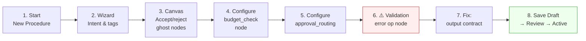
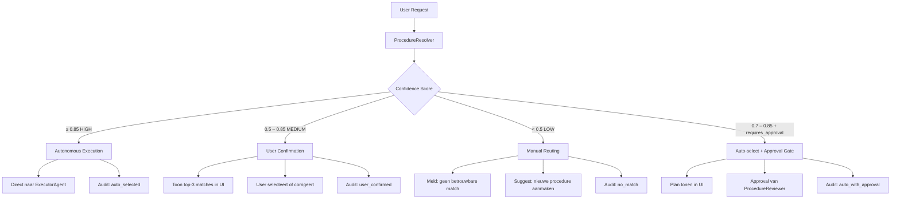
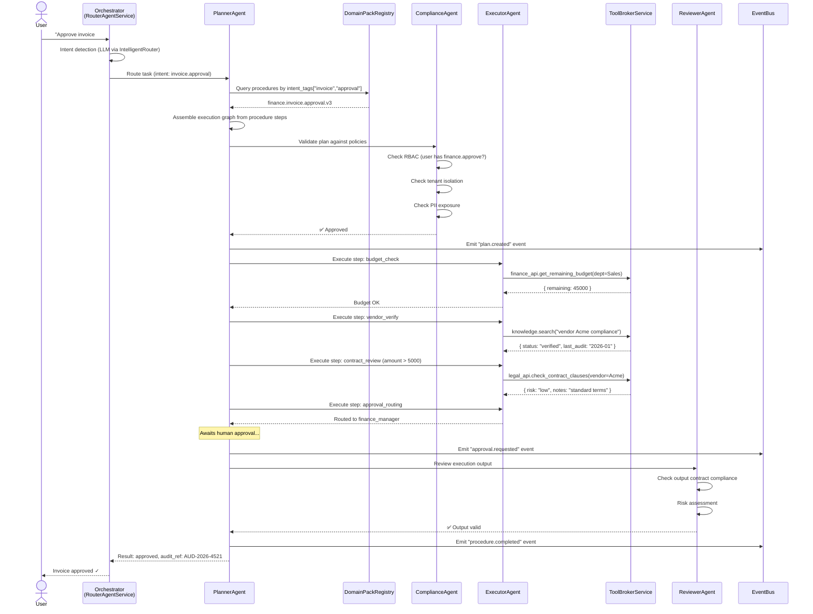
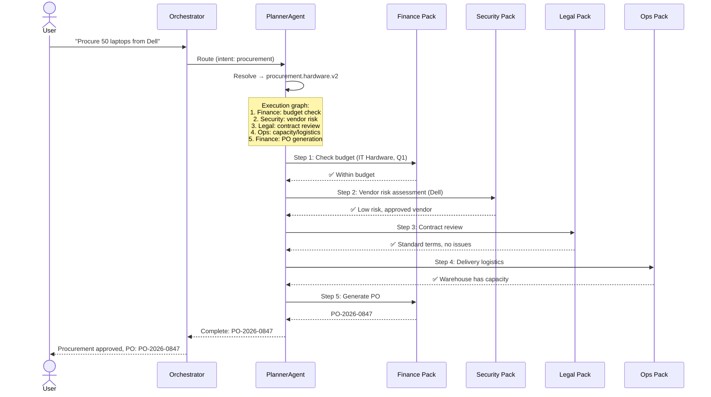
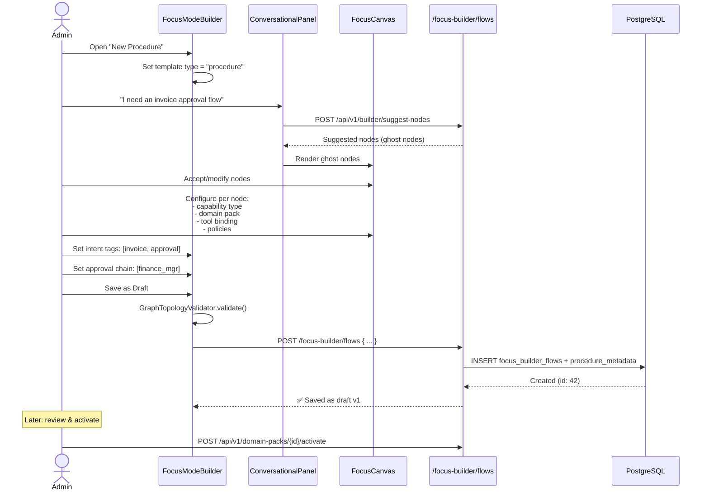
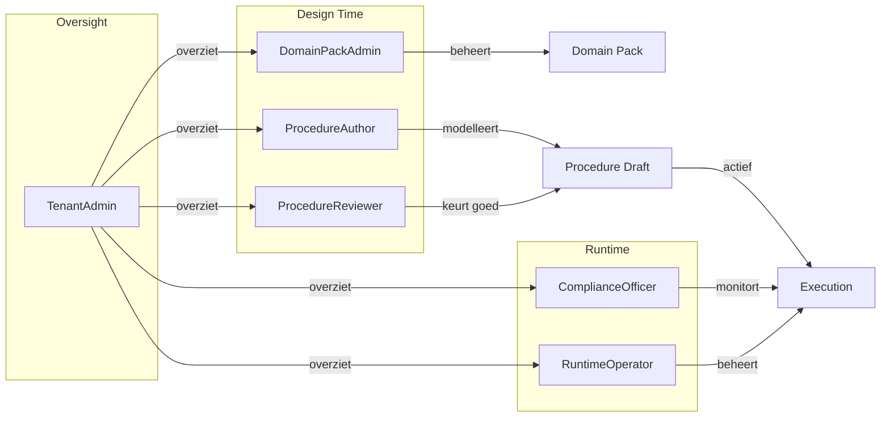
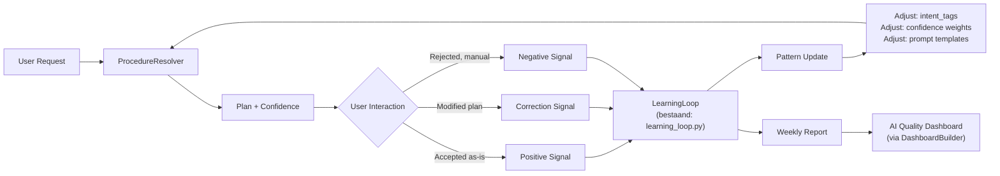
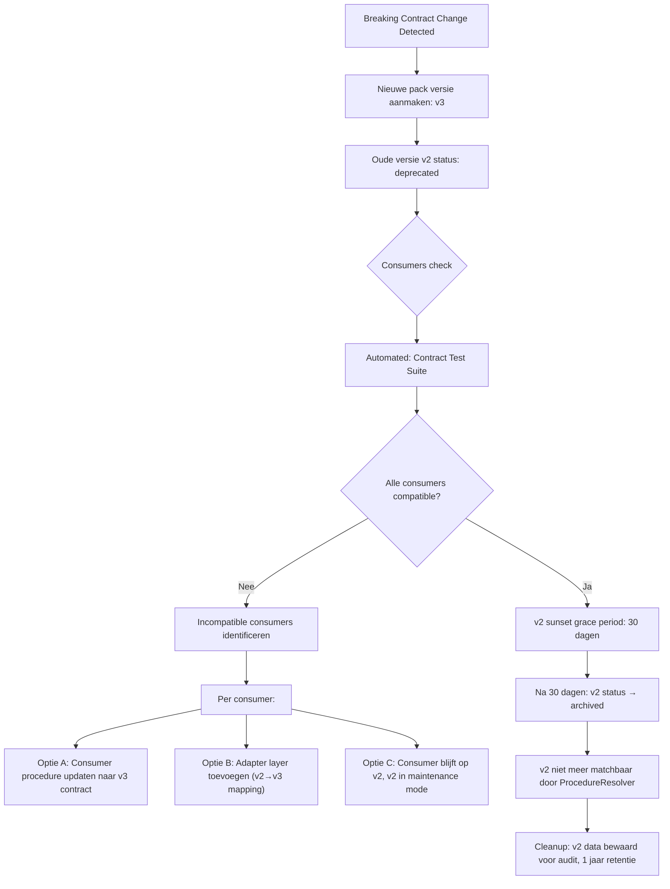

# Phase 3 — Intelligent Agents: Capability-Driven, Cross-Department Architecture

> **Version**: 2.0 — February 2026
> **Status**: Architecture & Implementation Plan
> **Authors**: SanskritiSetu Engineering
> **Last Updated**: 2026-02-08

---

## Inhoudsopgave

1. [Executive Summary](#1-executive-summary)
2. [Visie & Doelstellingen](#2-visie--doelstellingen)
   - 2.1–2.6 Probleem, doelstellingen, principes, phase positionering, NFRs, change management
   - [2.7 UX-principes voor Phase 3](#27-ux-principes-voor-phase-3)
   - [2.8 UX-Story: Finance Domain Pack Owner storyboard](#28-ux-story-finance-domain-pack-owner-maakt-eerste-invoice-procedure)
3. [Bestaande Infrastructuur (Inventory)](#3-bestaande-infrastructuur-inventory)
4. [Architectuur: Capability + Domain Pack Model](#4-architectuur-capability--domain-pack-model)
5. [Procedure Lifecycle: Invoer → Opslag → Gebruik door Agents](#5-procedure-lifecycle-invoer--opslag--gebruik-door-agents)
6. [Cross-Department Samenwerking](#6-cross-department-samenwerking)
7. [Database Schema's (Nieuw)](#7-database-schemas-nieuw)
8. [API Surface (Nieuw + Bestaand)](#8-api-surface-nieuw--bestaand)
9. [Frontend: Procedure Builder via FocusModeBuilder](#9-frontend-procedure-builder-via-focusmodebuilder)
10. [Security & Governance](#10-security--governance)
    - 10.1–10.7 RBAC, audit, tenant isolation, compliance, rol-landschap, admin tooling, DR
    - [10.8 Threat Model (STRIDE)](#108-threat-model-stride)
    - [10.9 Data Classificatie](#109-data-classificatie)
    - [10.10 Tenant-specifieke Compliance Policies](#1010-tenant-specifieke-compliance-policies)
11. [Observability & Monitoring](#11-observability--monitoring)
    - 11.1–11.5 Metrics, traces, alerts, dashboards, AI quality
    - [11.6 Runbook & Incident Response](#116-runbook--incident-response)
    - [11.7 Supportability](#117-supportability-hoe-een-support-engineer-onderzoekt)
12. [Versioning, Feature Flags & Rollout](#12-versioning-feature-flags--rollout)
13. [Testing Strategie](#13-testing-strategie)
14. [Risico's & Mitigaties](#14-risicos--mitigaties)
15. [Cost Modelling](#15-cost-modelling)
16. [Architecture Decision Records (ADRs)](#16-architecture-decision-records-adrs)
17. [Implementatie Roadmap (Sprints)](#17-implementatie-roadmap-sprints)
18. [Appendix: Bestaande Component Map](#18-appendix-bestaande-component-map)
19. [Deliverables bij Oplevering Phase 3](#19-deliverables-bij-oplevering-phase-3)
20. [Appendix A – Capability Agent Interfaces](#20-appendix-a--capability-agent-interfaces-normatief)
21. [Appendix B – Canonical JSON Schemas](#21-appendix-b--canonical-json-schemas)
22. [Appendix C – Procedure Node Types](#22-appendix-c--procedure-node-types-focusmodebuilder)
23. [Appendix D – Approval & Escalation](#23-appendix-d--approval--escalation-normatief)

---

## 1. Executive Summary

Phase 3 maakt departmental agents **agnostisch en intelligent** door een **capability + domain pack** architectuur. In plaats van per afdeling een nieuwe agent te bouwen, leveren afdelingen **procedures, policies en tool-bindings als data** (domain packs). Generieke **capability agents** (plannen, ophalen, uitvoeren, controleren, reviewen) assembleren per request een execution graph.

**Kernresultaat**: Finance, Legal, HR, Ops of elke andere afdeling kan 1000+ procedures toevoegen **zonder code-wijzigingen**, via de bestaande **FocusModeBuilder UI** of de **FocusBuilder API**.

---

## 2. Visie & Doelstellingen

### 2.1 Probleem

- Huidige agents zijn department-specifiek: `financial_agent.py`, `marketing_agent.py`, etc.
- Elke nieuwe procedure vereist code-aanpassingen.
- Cross-department workflows (bijv. procurement = Finance + Legal + Ops) zijn niet gemodelleerd.
- Geen standaard manier om procedures in te voeren, op te slaan of te activeren.

### 2.2 Doelstellingen

| # | Doelstelling | Meetbaar criterium |
|---|---|---|
| D1 | Agents zijn department-agnostisch | Geen department-specifieke code in capability agents |
| D2 | Procedures zijn data, niet code | Admin kan procedure toevoegen via UI/API zonder deploy |
| D3 | Cross-department workflows werken | ≥3 departments in één execution graph |
| D4 | Bestaande infra wordt hergebruikt | 0 duplicatie van bestaande services |
| D5 | Compliant met GDPR + EU AI Act | Audit trail op elke beslissing |
| D6 | 95% test coverage op nieuwe code | Coverage gate in CI |

### 2.3 Kernprincipes

1. **Capabilities boven departments** — generieke rollen, niet afdelingen
2. **Domain packs leveren kennis** — procedures, policies, tools, constraints
3. **FocusModeBuilder als universele editor** — geen nieuwe UI bouwen
4. **Governance first** — RBAC, tenant isolation, audit logging, policies
5. **Observability is architectuur** — tracing, metrics, alerts ingebouwd

### 2.4 Phase Positionering & Flagship Journeys

Phase 3 is **Phase 3 van 5** in het SanskritiSetu platform:

| Phase | Focus | Status |
|---|---|---|
| Phase 1 | Core platform: multi-tenant, auth, RBAC, base API | ✅ Productie |
| Phase 2 | Workflow builders, FocusModeBuilder, knowledge, dashboards | ✅ Productie |
| **Phase 3** | **Intelligent agents: capability-driven, cross-department** | 🔵 Dit document |
| Phase 4 | Autonomous operations: self-healing, predictive, continuous learning | ⬜ Gepland |
| Phase 5 | Ecosystem: marketplace, external agent federation, partner APIs | ⬜ Gepland |

**Flagship journeys (prioriteitsvolgorde)**:

| # | Journey | Departments | Waarom eerst |
|---|---|---|---|
| F1 | **Invoice Approval** | Finance | Meest voorkomend, duidelijke stappen, meetbare ROI |
| F2 | **Hardware Procurement** | Finance + Legal + Ops | Eerste cross-department proof, 3 packs in 1 flow |
| F3 | **Employee Onboarding** | HR + IT + Legal | Hoog volume, veel handmatige stappen, compliance-zwaar |
| F4 | **Contract Review** | Legal + Finance | Juridisch gevoelig, test van compliance guardrails |

> **Regel**: Geen nieuwe flagship toevoegen voordat F1 en F2 in productie draaien bij ≥1 tenant.

### 2.5 Non-Functional Requirements per Use Case

| Procedure Type | Latency (p50) | Latency (p95) | Max doorlooptijd (incl. human) | Beschikbaarheid | RPO | RTO |
|---|---|---|---|---|---|---|
| Fully automated (geen approval) | <2s | <5s | <30s | 99.9% | 1h | 4h |
| Single approval gate | <2s (auto steps) | <5s | <4h (SLA approval) | 99.9% | 1h | 4h |
| Multi-department (3+ packs) | <5s (auto steps) | <10s | <24h | 99.5% | 1h | 8h |
| Complex (5+ steps, 2+ approvals) | <5s (auto steps) | <15s | <48h | 99.5% | 1h | 8h |

**Approval SLA's**:

| Approval Level | Max wachttijd | Escalatie na |
|---|---|---|
| Team lead | 2h | → Manager |
| Manager | 4h | → Department head |
| Department head | 8h | → Tenant admin + notification |
| CFO/CLO (high-value) | 24h | → CEO + auto-hold |

**Rate limits** (per tenant, per minuut):

- Procedure executions: 100/min
- Procedure search: 500/min
- Domain pack mutations: 10/min
- LLM calls (via IntelligentRouter): 200/min

#### Code Implementation: Approval SLA & Escalation

Om de SLA's te handhaven, draait een achtergrond-job die escalaties triggert bij overschrijding:

```python
async def check_approval_sla(step_id: int):
    """
    (Deprecated) Zie Appendix D – Approval & Escalation voor de volledige implementatie.
    Deze functie is vervangen door een uitgebreider model met level-specific timers en config.
    """
    pass
```

### 2.6 Change Management & Adoptieplan

#### Rol: Domain Pack Owner

Elke afdeling wijst een **Domain Pack Owner** aan — verantwoordelijk voor het modelleren, testen en onderhouden van de procedures van die afdeling.

| Eigenschap | Beschrijving |
|---|---|
| Profiel | Senior medewerker met proceskennis + basiskennis IT |
| Verantwoordelijkheden | Procedures definiëren in FocusModeBuilder, output contracts valideren, pack versies beheren |
| Training | 2-daagse workshop (zie onder) + ongoing office hours |
| Beschikbaarheid | Min. 8u/week gedurende initiële modellering |
| Escalatiepunt | Voor procedure conflicten of cross-department afstemming |

#### Onboarding Programma per Afdeling

```
Week 1: Discovery
├── Inventarisatie huidige handmatige procedures (top 20)
├── Prioritering op basis van frequentie × complexiteit × foutgevoeligheid
└── Identificatie van cross-department touchpoints

Week 2: Workshop "Domain Pack Modellering"
├── Dag 1: FocusModeBuilder hands-on (procedure invoer)
│   ├── Node types, capability mapping
│   ├── Tool bindings configureren
│   └── Intent tags en output contracts definiëren
├── Dag 2: Testing & governance
│   ├── Contract tests schrijven (met template)
│   ├── Approval chains instellen
│   └── Review- en activeringsproces doorlopen

Week 3-4: Begeleide Modellering
├── Domain Pack Owner modelleert top-5 procedures
├── Engineering-buddy voor technische vragen
├── Daily standup (15 min) voor blokkades
└── Review door ProcedureReviewer + ComplianceOfficer

Week 5: Go-Live
├── Canary: 1 procedure actief voor beperkte gebruikersgroep
├── Monitoring: dagelijkse check op failures, SLA breaches
├── Feedback: wekelijkse retro met Domain Pack Owner
└── Iteratie: aanpassingen op basis van production data
```

#### Success Metrics per Afdeling

| Metric | Target (week 5) | Target (maand 3) |
|---|---|---|
| Procedures gemodelleerd | ≥5 | ≥20 |
| Procedures actief in productie | ≥1 | ≥10 |
| Gemiddelde execution success rate | ≥90% | ≥95% |
| Gemiddelde tijd procedure van draft → active | <5 dagen | <2 dagen |
| User satisfaction (Domain Pack Owner) | ≥3.5/5 | ≥4/5 |

### 2.7 UX-principes voor Phase 3

Doel van deze UX‑laag is dat een **Domain Pack Owner** met beperkte technische achtergrond zelfstandig procedures kan modelleren zonder bang te hoeven zijn “iets stuk te maken”.

**UX-principes**

1. **Guided, niet overloaded**
   - Nieuwe gebruikers starten altijd in een “guided mode” met korte tooltips en een simpele 3‑stappen wizard: (1) intent & doelen, (2) stappen kiezen, (3) governance (approval chain + policies).
   - Geavanceerde opties (custom JSON, complexe conditions) zijn standaard verborgen achter “Advanced” toggles.

2. **Altijd een veilige default**
   - Nieuwe procedures worden standaard als `draft` gemaakt, met expliciete “Review & Activate” stap, zodat een Domain Pack Owner nooit per ongeluk productie raakt.
   - Standaard templates (zoals `generic.invoice.approval.v1`) zijn readonly‑copy: de user maakt altijd eerst een lokale kopie vóór wijzigingen.

3. **Fouten zijn begrijpelijk en herstelbaar**
   - Validatie‑fouten (bijv. ontbrekende output contractvelden, ongeldige approval chain) worden direct op de betreffende node getoond, in platte taal, met een concrete suggestie (“Voeg minimaal één approver toe voor bedragen > €5.000”).
   - Er is een undo/redo‑stack per sessie en een duidelijke “compare with previous version” view bij het opslaan.

4. **Transparante AI-assistentie**
   - AI‑suggesties (ghost nodes) zijn altijd gemarkeerd als “Voorstel” en vereisen expliciete acceptatie per stap.
   - Bij elke AI‑gegenereerde flow wordt de confidence‑score zichtbaar getoond en uitgelegd (“85% zeker gebaseerd op 142 eerdere uitvoeringen in Finance”).

5. **Context altijd in beeld**
   - Boven de canvas staan altijd: actief domain pack, versie, status (draft/active/deprecated) en tenant.
   - Bij cross‑department flows wordt zichtbaar welke stappen tot welk domain pack behoren (kleur‑codering + legend).

### 2.8 UX-Story: “Finance Domain Pack Owner maakt eerste invoice-procedure”

Mini‑storyboard met 8 schermstappen, validaties en foutafhandeling:

| Stap | Scherm | Actie gebruiker | Systeem respons |
|---|---|---|---|
| 1 | **FocusModeBuilder startscherm** | Klikt “New Procedure” | Template wizard opent. Type pre-selected op “Procedure”. Domain pack dropdown toont Finance (default op basis van user’s department). Status badge: “Draft”. |
| 2 | **Wizard stap 1: Intent & doel** | Typt doel: “Factuur goedkeuren voor leveranciers > €500” | ConversationalPanel analyseert intent. Suggest intent tags: `[invoice, approval, vendor]`. Toont ghost nodes op canvas: 5 voorgestelde stappen. Confidence: 88%. |
| 3 | **Canvas met ghost nodes** | Bekijkt AI-suggesties. Accepteert 4 van 5 nodes, verwijdert “vendor_verify” (niet nodig voor deze tenant). | Ghost nodes worden vaste nodes. Verwijderde node verdwijnt. Canvas past layout automatisch aan. |
| 4 | **Node configuratie: budget_check** | Klikt op budget_check node, opent properties panel | NodePropertiesPanel toont: capability (executor, grayed out), tool binding dropdown (finance_api.get_remaining_budget), input mapping. “Advanced” toggle verbergt JSON editor. |
| 5 | **Node configuratie: approval_routing** | Kiest approval chain: “finance_manager” | Approval Chain Editor toont rolselector. Escalation rule auto‑suggested: “> €10.000 → CFO”. User accepteert. |
| 6 | **⚠️ Validatiefout** | Klikt “Save” | `GraphTopologyValidator` detecteert: output contract ontbreekt op execute_payment node. **Foutmelding direct op de node** (rode rand + tooltip): “Definieer een output contract: welke velden levert deze stap op? [✉ Voorbeeld bekijken]” |
| 7 | **Fix: output contract** | Klikt “Voorbeeld bekijken”, past contract aan: `{status, approved_by, audit_ref}` | Validatie slaagt. Groene checkmark op alle nodes. “Save as Draft” knop wordt actief. |
| 8 | **Opslaan & review** | Klikt “Save as Draft”, later: “Request Review” | Procedure opgeslagen met `version 1`, `status: draft`. Notificatie naar ProcedureReviewer. Na approval: status → “active”. Zichtbaar in Governance Dashboard. |



---

## 3. Bestaande Infrastructuur (Inventory)

> **Kritisch**: Phase 3 bouwt voort op wat er al is. Hieronder de complete inventory.

### 3.1 Agent Framework

| Component | Locatie | Status |
|---|---|---|
| `BaseAgent` (ABC) | `src/core/shared/interfaces.py` | ✅ Productie |
| `EnhancedBaseAgent` (DI, events, tracing) | `src/core/agents/base_agent.py` | ✅ Productie |
| `AgentRegistry` (DB, cache, health) | `src/core/agents/agent_registry.py` | ✅ Productie |
| `AgentFactory` (77+ agents uit markdown) | `src/core/agents/agent_factory.py` | ✅ Productie |
| `SubagentLoader` (discovery, loading) | `src/core/agents/subagent_loader.py` | ✅ Productie |
| `RouterAgentService` (LLM routing) | `src/core/agents/router_agent_service.py` | ✅ Productie |
| `WorkflowEngine` (seq/parallel/mixed) | `src/core/agents/workflow_engine.py` | ✅ Productie |
| `WorkflowOrchestratorAgent` (LLM analyze) | `src/core/agents/workflow_orchestrator_agent.py` | ✅ Productie |
| `LearningLoop` (pattern recognition) | `src/core/agents/learning_loop.py` | ✅ Productie |
| `StrategyEngine` (strategic planning) | `src/core/agents/strategy_engine.py` | ✅ Productie |
| `CommunicationProtocol` | `src/core/agents/communication_protocol.py` | ✅ Productie |

### 3.2 Bestaande Specialist Agents

| Agent | Bestand | Wordt in Phase 3 |
|---|---|---|
| `financial_agent.py` | `src/core/agents/financial_agent.py` | → Finance Domain Pack provider |
| `marketing_agent.py` | `src/core/agents/marketing_agent.py` | → Marketing Domain Pack provider |
| `security_agent.py` | `src/core/agents/security_agent.py` | → Security Domain Pack provider |
| `research_agent.py` | `src/core/agents/research_agent.py` | → Research Domain Pack provider |
| `product_agent.py` | `src/core/agents/product_agent.py` | → Product Domain Pack provider |
| `ethics_agent.py` | `src/core/agents/ethics_agent.py` | → ComplianceAgent input |
| `executor_agent.py` | `src/core/agents/executor_agent.py` | → ExecutorAgent basis |
| `autonomous_agent.py` | `src/core/agents/autonomous_agent.py` | → PlannerAgent input |

### 3.3 FocusBuilder (Backend + Frontend)

| Component | Locatie | Doel in Phase 3 |
|---|---|---|
| `FocusBuilderService` | `src/core/focus_builder/service.py` | **Procedure CRUD + execution** |
| `FocusBuilderFlow` model | `src/core/focus_builder/models.py` | **Procedure opslag** (tabel: `focus_builder_flows`) |
| `FlowRepository` | `src/core/focus_builder/repositories.py` | **Tenant-isolated persistence** |
| `GraphTopologyValidator` | `src/core/focus_builder/validators.py` | **DAG validation** (max 100 nodes/500 edges) |
| `FlowCreate/Update` schemas | `src/core/focus_builder/schemas.py` | **Input validation** |
| API: `/focus-builder/*` | `src/core/api/focus_builder_endpoints.py` | **REST API voor procedures** |
| `FocusModeBuilder` UI | `frontend/src/components/workflow/FocusModeBuilder.tsx` | **Visuele procedure editor** |
| `FocusCanvas` | `frontend/src/components/workflow/FocusCanvas.tsx` | **ReactFlow canvas** |
| `ConversationalPanel` | `frontend/src/components/workflow/ConversationalPanel.tsx` | **AI-assisted procedure building** |
| Zustand store | `frontend/src/store/useWorkflowBuilderStore.ts` | **Client state** |

### 3.4 WorkflowBuilder (Frontend)

| Component | Locatie | Doel in Phase 3 |
|---|---|---|
| `WorkflowBuilder` | `frontend/src/components/workflow/WorkflowBuilder.tsx` | **Visuele workflow editor** |
| `WorkflowCanvas` (800 lines) | `frontend/src/components/workflow/WorkflowCanvas.tsx` | **Drag-drop, zoom, grid** |
| `NodePalette` (525 lines) | `frontend/src/components/workflow/NodePalette.tsx` | **Draggable node types** |
| `SOPFlowEditor` | `frontend/src/components/workflow/SOPFlowEditor.tsx` | **SOP visual editor** → `/api/v1/sops/{id}/visual` |
| `WorkflowAgentPanel` | `frontend/src/components/workflow/WorkflowAgentPanel.tsx` | **Agent assignment in workflows** |
| `ComplianceOverlay` | `frontend/src/components/workflow/ComplianceOverlay.tsx` | **Compliance checks** |
| `WorkflowImportModal` | `frontend/src/components/workflow/WorkflowImportModal.tsx` | **Import JSON/YAML** |
| `TemplateWorkflowBuilder` | `frontend/src/components/templates/TemplateWorkflowBuilder.tsx` | **Template → workflow instantiation** |

### 3.5 Supporting Services

| Service | Locatie | Functie |
|---|---|---|
| `ToolBrokerService` | `src/core/tool_broker/service.py` | Tool execution + circuit breaker + retry |
| `LLMService` (multi-provider) | `src/core/llm/llm_service.py` | Gemini, DeepSeek, Ollama, cost optimization |
| `IntelligentRouter` | `src/core/llm/intelligent_router.py` | Model selectie per task |
| `ActivePiecesClient` | `src/core/activepieces/client.py` | Workflow execution engine |
| `FlowTransformer` | `src/core/activepieces/transformer.py` | ReactFlow → ActivePieces JSON |
| `FocusSuggestionService` | `src/core/services/focus_suggestion_service.py` | AI node suggestions + Redis cache |
| `KnowledgeService` | `src/core/knowledge/knowledge_service.py` | Knowledge CRUD |
| `RetrievalEngine` | `src/core/knowledge/retrieval_engine.py` | Vector-based semantic search |
| `KnowledgeGraph` | `src/core/knowledge/knowledge_graph.py` | Entity-relation graph |
| `EmbeddingService` | `src/core/knowledge/embedding_service.py` | Embedding generation |
| `CommunicationManager` | `src/core/communication/communication_manager.py` | Redis pub/sub, M-MDP protocol |
| `PubSubManager` | `src/core/events/pubsub_manager.py` | Real-time event bus |
| `EventBus` (OODA) | `src/core/memory/event_bus.py` | OODA-loop events + vector storage |
| `MemoryManager` | `src/core/memory/memory_manager.py` | Strategic/tactical/episodic memory |
| `PolicyEngine` | `src/core/governance/policy_engine.py` | Domain blocking, approval, risk |
| `AgentRegistryMesh` | `src/core/collaboration/agent_mesh.py` | Health tracking, capability discovery |
| `TaskCoordinator` | `src/core/collaboration/task_coordinator.py` | Collaborative task management |
| `ConsensusEngine` | `src/core/collaboration/consensus_engine.py` | Agent consensus |

### 3.6 Frontend Additioneel

| Component | Locatie | Functie |
|---|---|---|
| `MissionBuilder` (619 lines) | `frontend/src/components/mission/MissionBuilder.tsx` | Step-by-step mission creation |
| `MissionControl` (OODA) | `frontend/src/pages/MissionControl.tsx` | Observe/Orient/Decide/Act dashboard |
| `DashboardBuilder` | `frontend/src/components/dashboard/DashboardBuilder.tsx` | 13 widget types, drag-drop |
| `AICopilotPanel` | `frontend/src/components/copilot/AICopilotPanel.tsx` | WebSocket AI copilot |
| `AgentDock` | `frontend/src/components/agent-dock/AgentDock.tsx` | Persistent mission sidebar |
| `ExplainabilityPanel` | `frontend/src/components/explainability/ExplainabilityPanel.tsx` | Reasoning chain display |
| `GovernanceAgentPanel` | `frontend/src/components/governance/GovernanceAgentPanel.tsx` | Governance UI |
| `KnowledgeBasePanel` | `frontend/src/components/knowledge/KnowledgeBasePanel.tsx` | Knowledge management |
| `SwarmStreamPanel` | `frontend/src/components/swarm/SwarmStreamPanel.tsx` | Agent swarm view |

---

## 4. Architectuur: Capability + Domain Pack Model

### 4.1 Conceptueel Model

```
┌──────────────────────────────────────────────────────────┐
│                    User Request                          │
└─────────────────────────┬────────────────────────────────┘
                          │
                          ▼
┌──────────────────────────────────────────────────────────┐
│              Orchestrator (bestaand)                      │
│  WorkflowOrchestratorAgent + RouterAgentService          │
│  → Intent detectie → Capabilities + Domain Packs kiezen  │
└─────────────────────────┬────────────────────────────────┘
                          │
              ┌───────────┼───────────┐
              ▼           ▼           ▼
       ┌─────────┐ ┌──────────┐ ┌──────────┐
       │ Planner │ │ Retriever│ │ Compliance│    ◄── Capability Agents
       │  Agent  │ │  Agent   │ │  Agent    │        (generiek)
       └────┬────┘ └────┬─────┘ └────┬─────┘
            │            │            │
            ▼            ▼            ▼
       ┌─────────────────────────────────────┐
       │        Domain Pack Registry          │
       │  ┌─────────┐ ┌───────┐ ┌─────────┐ │
       │  │ Finance  │ │ Legal │ │   Ops   │ │    ◄── Domain Packs
       │  │ Pack v3  │ │Pack v2│ │ Pack v1 │ │        (data, niet code)
       │  └─────────┘ └───────┘ └─────────┘ │
       └──────────────────┬──────────────────┘
                          │
              ┌───────────┼───────────┐
              ▼           ▼           ▼
       ┌─────────┐ ┌──────────┐ ┌──────────┐
       │Executor │ │ Tool     │ │ Reviewer │    ◄── Execution
       │ Agent   │ │ Broker   │ │  Agent   │
       └─────────┘ └──────────┘ └──────────┘
```

### 4.2 Capability Agents (Nieuw, extends EnhancedBaseAgent)

| Capability Agent | Verantwoordelijkheid | Basis |
|---|---|---|
| `PlannerAgent` | Intent → execution plan met stappen | Extends `EnhancedBaseAgent` + `StrategyEngine` |
| `RetrieverAgent` | Kennis/records ophalen uit KnowledgeBase + vector search | Extends `EnhancedBaseAgent` + `RetrievalEngine` |
| `ExecutorAgent` | Stappen uitvoeren via `ToolBrokerService` | Extends bestaande `executor_agent.py` |
| `ComplianceAgent` | RBAC, tenant, PII, policy checks via `PolicyEngine` | Extends `EnhancedBaseAgent` + `ethics_agent.py` |
| `ReviewerAgent` | Output quality, risk assessment, handoff beslissing | Extends `EnhancedBaseAgent` + `LearningLoop` |

**Locatie**: `src/core/agents/capabilities/` — ⚠️ _nieuw, aan te maken in Sprint 2_

```python
# src/core/agents/capabilities/planner_agent.py  [PLANNED – Sprint 2]
from src.core.agents.base_agent import EnhancedBaseAgent
from src.core.agents.strategy_engine import StrategyEngine
from src.core.governance.policy_engine import PolicyEngine
from src.core.types import AgentType

class PlannerAgent(EnhancedBaseAgent):
    """Assembleert een execution plan op basis van intent + domain packs."""

    def __init__(
        self,
        strategy_engine: StrategyEngine,
        domain_pack_registry: DomainPackRegistry,
        policy_engine: PolicyEngine,
    ):
        super().__init__(agent_type=AgentType.ORCHESTRATOR)
        self._strategy = strategy_engine
        self._registry = domain_pack_registry
        self._policy = policy_engine

    async def process_task(self, task: TaskData) -> ExecutionResult:
        # 1. Parse intent
        # 2. Query registry voor matching procedures
        # 3. Assembleer execution graph
        # 4. Valideer tegen policies
        # 5. Return plan
        ...
```

### 4.3 Domain Packs (Data, niet code)

Een domain pack is een **verzameling procedures, policies, tools en constraints** die door een afdeling wordt beheerd. Het wordt opgeslagen als een `FocusBuilderFlow` (bestaand model) met uitgebreide metadata.

```
Domain Pack = {
    id, name, version, department,
    procedures: [Procedure],           # Stappen-templates
    policies: [Policy],                 # Guardrails en constraints
    tool_bindings: [ToolBinding],       # API connectors, DB queries
    data_catalog: [DataCatalogEntry],   # Toegestane entities en velden
    output_contracts: [OutputContract], # Wat de output moet bevatten
    approval_chains: [ApprovalChain],   # Wie moet goedkeuren
}
```

**Opslag**: Uitbreiding van `focus_builder_flows` tabel + nieuwe relatie-tabellen.

### 4.4 Architectuurdiagram (Mermaid)

```mermaid
flowchart TB
    subgraph "Frontend (bestaand)"
        FMB[FocusModeBuilder<br/>Procedure Editor]
        WB[WorkflowBuilder<br/>Workflow Editor]
        MB[MissionBuilder<br/>Mission Creator]
        DASH[DashboardBuilder<br/>Monitoring]
    end

    subgraph "API Layer (bestaand + uitbreiding)"
        FB_API["/focus-builder/*<br/>Procedure CRUD"]
        WF_API["/api/v1/workflows/*<br/>Workflow CRUD"]
        AG_API["/api/v1/agents/*<br/>Agent Management"]
        DP_API["/api/v1/domain-packs/*<br/>NEW: Pack Registry"]
        PROC_API["/api/v1/procedures/*<br/>NEW: Procedure Query"]
    end

    subgraph "Capability Agents (nieuw)"
        PA[PlannerAgent]
        RA[RetrieverAgent]
        EA[ExecutorAgent]
        CA[ComplianceAgent]
        RVA[ReviewerAgent]
    end

    subgraph "Domain Pack Registry (nieuw)"
        DPR[DomainPackRegistry]
        FP[Finance Pack]
        LP[Legal Pack]
        HP[HR Pack]
        OP[Ops Pack]
    end

    subgraph "Bestaande Services"
        AR[AgentRegistry]
        WE[WorkflowEngine]
        TB[ToolBrokerService]
        LLM[LLMService]
        KB[KnowledgeService +<br/>RetrievalEngine]
        PE[PolicyEngine]
        EB[EventBus + PubSub]
        MM[MemoryManager]
        CM[CommunicationManager]
    end

    subgraph "Storage"
        DB[(PostgreSQL<br/>focus_builder_flows<br/>domain_packs<br/>procedures)]
        REDIS[(Redis<br/>Cache + PubSub)]
        VECTOR[(Vector Store<br/>Embeddings)]
    end

    FMB --> FB_API
    WB --> WF_API
    MB --> AG_API

    FB_API --> DPR
    DP_API --> DPR
    PROC_API --> DPR

    DPR --> FP & LP & HP & OP

    PA --> DPR
    PA --> PE
    RA --> KB
    EA --> TB
    CA --> PE
    RVA --> LLM

    PA & RA & EA & CA & RVA --> AR
    PA & RA & EA & CA & RVA --> EB
    PA & RA & EA & CA & RVA --> MM

    DPR --> DB
    KB --> VECTOR
    EB --> REDIS
    AR --> DB
```



### 4.5 Prompt Architecture & Guardrails per Capability

Elke capability agent heeft een **system prompt template** met strikte guardrails. Prompts worden als versioned templates beheerd (niet hard-coded) zodat ze zonder deploy aanpasbaar zijn.

```python
# src/core/agents/capabilities/prompts.py  [PLANNED – Sprint 2]

PLANNER_SYSTEM_PROMPT = """
You are a PlannerAgent for the SanskritiSetu platform.

ROLE: Assemble an execution plan from registered procedures and domain packs.

GUARDRAILS:
1. NEVER invent procedure steps that are not in the DomainPackRegistry.
2. NEVER assume tool bindings — only use tools explicitly registered in the domain pack.
3. If no procedure matches the intent with confidence >= 0.7, respond with
   {"action": "request_human_confirmation", "candidates": [...], "confidence": <float>}.
4. NEVER include PII in plan descriptions or logs.
5. Always include tenant_id scope in every data query.
6. Maximum {max_steps} steps per plan. If more needed, split into sub-plans.

CONTEXT (injected at runtime):
- Tenant: {tenant_id}
- User permissions: {user_scopes}
- Available domain packs: {active_packs}
- Matched procedures: {matched_procedures}
- Cost budget remaining: {remaining_budget}

OUTPUT FORMAT (strict JSON):
{
  "plan_id": "uuid",
  "steps": [{"id": "str", "capability": "enum", "domain_pack": "str",
              "tool": "str", "input": {}, "requires_approval": bool}],
  "estimated_cost_tokens": int,
  "confidence": float
}"""

RETRIEVER_SYSTEM_PROMPT = """
You are a RetrieverAgent for the SanskritiSetu platform.

ROLE: Retrieve relevant knowledge, documents, and records for a given query.

GUARDRAILS:
1. Only return data from the tenant's own knowledge base (tenant_id={tenant_id}).
2. Include source references (document_id, chunk_id) for every fact.
3. If retrieval confidence < 0.5, flag as "low_confidence" and suggest alternatives.
4. NEVER fabricate data. If no results found, return empty with explanation.
5. Apply data_catalog filters from the domain pack — only expose allowed fields.
"""

COMPLIANCE_SYSTEM_PROMPT = """
You are a ComplianceAgent for the SanskritiSetu platform.

ROLE: Validate plans and data against policies, RBAC, PII rules, and regulations.

GUARDRAILS:
1. ALWAYS check: RBAC permissions, tenant isolation, PII exposure, policy constraints.
2. Block execution on ANY policy violation — no exceptions.
3. Flag but don't block on warnings (e.g., unusual amount, first-time vendor).
4. Log every decision with reasoning in audit_trail.
5. If uncertain about a policy interpretation, escalate to ComplianceOfficer role.
"""
```

**Hallucination Mitigation bij Procedure Discovery**:

| Scenario | Strategie |
|---|---|
| Conflicterende matches (2+ procedures, vergelijkbare confidence) | Toon alle kandidaten in UI, user kiest. Log als `ambiguous_match` voor LearningLoop. |
| Lage confidence (<0.5) | Geen automatische executie. Suggestie tonen in ConversationalPanel met "Bedoelde u...?" |
| Geen match | Meld aan user: "Geen procedure gevonden. Wilt u een nieuwe aanmaken?" + link naar FocusModeBuilder. |
| Semantic search vs. GIN index mismatch | GIN (exact tags) wint altijd. Semantic is alleen fallback. Bij conflict: GIN resultaat. |

### 4.6 Confidence & Autonomy Model

De `PlannerAgent` mag **niet altijd autonoom beslissen**. Het confidence-niveau bepaalt het pad:



**Confidence berekening**:

```python
# src/core/agents/capabilities/confidence_scorer.py  [PLANNED – Sprint 2]

class ConfidenceScorer:
    """
    Berekent confidence score voor procedure matching.
    Combineert tag overlap, semantic similarity, historical success, recency en user context.
    """

    WEIGHTS = {
        "tag_overlap": 0.35,
        "semantic_similarity": 0.25,
        "historical_success": 0.20,
        "recency": 0.10,
        "user_context": 0.10,
    }

    async def score(self, intent: str, candidates: list, user: User, tenant_id: int) -> list:
        # Pre-compute intent embedding
        intent_embedding = await self._embeddings.embed_text(intent)

        scored = []
        for proc in candidates:
            breakdown = {
                "tag_overlap": self._tag_overlap(intent, proc.intent_tags),
                "semantic_similarity": await self._semantic_score(intent_embedding, proc),
                "historical_success": await self._historical_score(proc.id, tenant_id),
                "recency": self._recency_score(proc.updated_at),
                "user_context": self._user_context_score(user, proc)
            }

            total = sum(self.WEIGHTS[k] * v for k, v in breakdown.items())
            scored.append(ScoredProcedure(procedure=proc, confidence=total, score_breakdown=breakdown))

        return sorted(scored, key=lambda s: s.confidence, reverse=True)

    async def _historical_score(self, procedure_id: int, tenant_id: int) -> float:
        """Success rate based on execution history (weighted by volume)."""
        stmt = select(
            func.count(ProcedureExecution.id).label("total"),
            func.sum(func.cast(ProcedureExecution.status == "completed", Integer)).label("success")
        ).where(
            ProcedureExecution.procedure_id == procedure_id,
            ProcedureExecution.tenant_id == tenant_id
        ).limit(100)

        row = (await self._db.execute(stmt)).first()
        if not row or row.total == 0: return 0.5

        base_rate = (row.success or 0) / row.total
        # Penalize low volume (<5), bonus for high volume (>100)
        confidence_factor = min(row.total / 5, 1.0)
        return base_rate * confidence_factor

    def _user_context_score(self, user: User, proc: ResolvedProcedure) -> float:
        """Boost score if user department matches domain pack."""
        score = 0.0
        if user.department and user.department.lower() == proc.domain_pack.lower():
            score += 0.5
        if any(proc.domain_pack.lower() in role.lower() for role in user.roles):
            score += 0.3
        return min(score, 1.0)
```

**Confidence thresholds** (configureerbaar per tenant via feature flags):

| Threshold | Waarde (default) | Gedrag |
|---|---|---|
| `HIGH_CONFIDENCE` | ≥ 0.85 | Autonoom uitvoeren |
| `MEDIUM_CONFIDENCE` | 0.50 – 0.85 | User confirmation in UI |
| `LOW_CONFIDENCE` | < 0.50 | Geen automatische actie, suggesties tonen |
| `AMBIGUOUS_MATCH` | Top-2 verschil < 0.10 | Altijd user confirmation, ongeacht absolute score |

---

## 5. Procedure Lifecycle: Invoer → Opslag → Gebruik door Agents

### 5.1 Hoe wordt een procedure ingevoerd?

**Via de bestaande FocusModeBuilder UI** — er hoeft geen nieuwe UI gebouwd te worden.

```
Admin opent FocusModeBuilder
    → Kiest "New Procedure" (nieuw template type)
    → AI Copilot helpt met stappen definiëren (ConversationalPanel)
    → Admin configureert per stap:
        - Capability type (plan, retrieve, execute, comply, review)
        - Domain pack toewijzing
        - Tool bindings (via NodePalette)
        - Policies en constraints
        - Approval chain
    → GraphTopologyValidator valideert DAG
    → Opslaan via FocusBuilderService.create_flow()
    → Versie wordt "draft" → review → "active"
```

**Via de API** (voor bulk import of CI/CD):

```
POST /focus-builder/flows
Content-Type: application/json
Authorization: Bearer <jwt>

{
    "name": "finance.invoice.approval.v3",
    "description": "Invoice approval procedure for amounts > €500",
    "react_flow_graph": { ... },  // Bestaand schema
    "metadata": {
        "type": "procedure",
        "domain_pack": "finance",
        "version": "3",
        "intent_tags": ["invoice", "approval", "vendor"],
        "approval_chain": ["finance_manager", "cfo"],
        "policies": ["max_amount_check", "vendor_verification"]
    }
}
```

**Via YAML/JSON import** (bestaande WorkflowImportModal):

```yaml
# procedure.yaml — importeerbaar via WorkflowImportModal
name: finance.invoice.approval
version: 3
domain_pack: finance
intent_tags: [invoice, approval, vendor]
steps:
  - id: validate_input
    capability: compliance
    policy_checks: [rbac, tenant, pii, max_amount]
  - id: budget_check
    capability: executor
    tool: finance_api.get_remaining_budget
    input: { department_id: "$input.department_id" }
  - id: vendor_verify
    capability: retriever
    knowledge_query: "vendor compliance status for $input.vendor_id"
  - id: contract_review
    capability: executor
    domain: legal
    tool: legal_api.check_contract_clauses
    condition: "$input.amount > 5000"
  - id: approval_routing
    capability: planner
    approval_chain: [finance_manager]
    escalation: { condition: "$input.amount > 10000", to: cfo }
  - id: execute_payment
    capability: executor
    tool: finance_api.initiate_payment
    requires_approval: true
output_contract:
  status: enum[approved, rejected, escalated]
  approved_by: string
  audit_ref: string
```

### 5.2 Waar wordt de data opgeslagen?

```
┌─────────────────────────────────────────────────────────┐
│                    PostgreSQL                             │
│                                                          │
│  focus_builder_flows (BESTAAND)                         │
│  ├── id, name, description, tenant_id                   │
│  ├── react_flow_graph (JSONB)     ← visuele definitie   │
│  ├── metadata (JSONB)             ← domain pack, tags   │
│  ├── version, status (draft/active/deprecated)          │
│  └── created_by, updated_at                             │
│                                                          │
│  domain_packs (NIEUW)                                   │
│  ├── id, name, department, version, tenant_id           │
│  ├── policies (JSONB)                                   │
│  ├── tool_bindings (JSONB)                              │
│  ├── data_catalog (JSONB)                               │
│  └── output_contracts (JSONB)                           │
│                                                          │
│  procedure_metadata (NIEUW, 1:1 op focus_builder_flows) │
│  ├── flow_id (FK → focus_builder_flows)                 │
│  ├── domain_pack_id (FK → domain_packs)                 │
│  ├── intent_tags (ARRAY, GIN index voor snelle lookup)  │
│  ├── approval_chain (JSONB)                             │
│  ├── output_contract (JSONB)                            │
│  └── max_execution_time_seconds                         │
│                                                          │
│  procedure_executions (NIEUW)                           │
│  ├── id, procedure_id, tenant_id                        │
│  ├── execution_graph (JSONB)                            │
│  ├── status, started_at, completed_at                   │
│  ├── initiated_by, approved_by                          │
│  └── audit_trail (JSONB)                                │
└─────────────────────────────────────────────────────────┘

┌─────────────────────────────────────────────────────────┐
│  Redis (BESTAAND)                                       │
│  ├── Procedure metadata cache (via FlowRepository)      │
│  ├── Intent → procedure mapping cache                   │
│  └── Active execution state                             │
└─────────────────────────────────────────────────────────┘

┌─────────────────────────────────────────────────────────┐
│  Vector Store (BESTAAND via RetrievalEngine)            │
│  ├── Procedure descriptions embedded                    │
│  ├── Intent tag embeddings                              │
│  └── Semantic procedure discovery                       │
└─────────────────────────────────────────────────────────┘
```

### 5.3 Hoe gebruiken agents de procedures?



### 5.4 Intent → Procedure Matching (detail)

```python
# src/core/agents/capabilities/procedure_resolver.py  [PLANNED – Sprint 2]

class ProcedureResolver:
    """Vindt de juiste procedure op basis van user intent."""

    def __init__(
        self,
        registry: DomainPackRegistry,
        retrieval_engine: RetrievalEngine,  # Bestaand
        cache: Redis,                        # Bestaand
    ):
        self._registry = registry
        self._retrieval = retrieval_engine
        self._cache = cache

    async def resolve(
        self, intent: str, tenant_id: int
    ) -> list[ResolvedProcedure]:
        # 1. Exact match op intent_tags (snel, via GIN index)
        exact = await self._registry.find_by_tags(
            tags=extract_tags(intent), tenant_id=tenant_id
        )
        if exact:
            return exact

        # 2. Semantic search via RetrievalEngine (bestaand)
        semantic = await self._retrieval.search(
            query=intent, top_k=5, tenant_id=tenant_id
        )
        return self._rank_and_filter(semantic)

        # 3. LLM fallback: ask LLMService to classify intent
        # (alleen als 1 en 2 geen resultaat geven)
```

---

## 6. Cross-Department Samenwerking

### 6.1 Hoe werkt het?

De `PlannerAgent` kan **meerdere domain packs** combineren in één execution graph. Elke stap specificeert zijn domain en de orchestrator routeert naar de juiste tools.



### 6.2 Inter-Department Contracts

Elk domain pack definieert **output contracts** die andere packs kunnen consumeren:

| Domain Pack | Output Contract | Levert |
|---|---|---|
| Finance | `finance.budget_check` | `{ available: bool, remaining: float, currency: str }` |
| Finance | `finance.approval` | `{ status: enum, approved_by: str, limits: dict }` |
| Legal | `legal.contract_review` | `{ risk_level: enum, clauses: list, exceptions: list }` |
| Legal | `legal.compliance_check` | `{ compliant: bool, violations: list }` |
| Ops | `ops.capacity_check` | `{ available: bool, timeline: str, constraints: list }` |
| HR | `hr.person_verification` | `{ active: bool, department: str, clearance: str }` |
| Security | `security.vendor_risk` | `{ risk_score: float, approved: bool, last_audit: date }` |

### 6.3 Data Boundaries

- Elke stap krijgt **alleen de data die het contract voorschrijft** (data minimization).
- `ComplianceAgent` controleert vóór elke stap of de doorgestuurde data PII bevat.
- Cross-tenant data flow is **geblokkeerd** door middleware.

### 6.4 Authorization Implementation (ADR-007)

We implementeren een **expliciete authorization model** via de `cross_department_authorizations` tabel.

```python
# src/core/agents/capabilities/compliance_agent.py (extension)
async def validate_cross_department_access(
    self, source_pack_id: int, target_pack_id: int, entity_type: str, operation: str
) -> bool:
    """Valideer of cross-department access toegestaan is (GAP FIX §6.2)."""
    stmt = select(CrossDepartmentAuthorization).where(
        CrossDepartmentAuthorization.source_domain_pack_id == source_pack_id,
        CrossDepartmentAuthorization.target_domain_pack_id == target_pack_id,
        CrossDepartmentAuthorization.permission_type == operation,
    )
    auth = await self._db.execute(stmt).scalar_one_or_none()

    if not auth:
        raise PermissionDenied(f"No authorization for {source_pack_id} -> {target_pack_id}")

    if auth.expires_at and auth.expires_at < datetime.utcnow():
        raise PermissionDenied("Authorization expired")

    if entity_type not in auth.allowed_entities:
        raise PermissionDenied(f"Entity '{entity_type}' not allowed")

    await self._log_access(auth.id, source_pack_id, target_pack_id, entity_type)
    return True
```

---

## 7. Database Schema's (Nieuw)

> **Implementatie‑noot (Sprint 1):**
> De UUID‑varianten van `domain_packs`, `procedure_metadata`, `procedure_executions` en `aiqualityevents` zoals gespecificeerd in `PHASE_3_INTELLIGENT_AGENTS-sprint-1.md` zijn de **canonieke** schema’s. De integer‑gebaseerde voorbeelden in deze sectie zijn historische referentie en worden in nieuwe code niet meer gebruikt.

> ⚠️ **Pad-conventie**: De package `src/core/domain_packs/` bestaat nog niet en wordt aangemaakt in **Sprint 1** (zie §17). Onderstaande code is de _target implementation_; tot die tijd ligt alle procedure-logica in het bestaande `src/core/focus_builder/`.

### 7.1 Domain Packs

```python
# src/core/domain_packs/models.py  [PLANNED – Sprint 1]
from sqlalchemy import Column, Integer, String, ForeignKey, DateTime, ARRAY, Index, UniqueConstraint
from sqlalchemy.dialects.postgresql import JSONB
from sqlalchemy.sql import func
from src.core.database.database import Base

class DomainPack(Base):
    __tablename__ = "domain_packs"

    id = Column(Integer, primary_key=True)
    tenant_id = Column(Integer, ForeignKey("tenants.id", ondelete="CASCADE"), nullable=False, index=True)
    name = Column(String(255), nullable=False)           # "finance", "legal"
    department = Column(String(100), nullable=False)
    version = Column(Integer, nullable=False, default=1)
    status = Column(String(50), default="draft")         # draft, active, deprecated
    policies = Column(JSONB, default=dict)
    tool_bindings = Column(JSONB, default=dict)
    data_catalog = Column(JSONB, default=dict)
    output_contracts = Column(JSONB, default=dict)
    created_by = Column(Integer, ForeignKey("users.id"))
    created_at = Column(DateTime, server_default=func.now())
    updated_at = Column(DateTime, onupdate=func.now())

    __table_args__ = (
        UniqueConstraint("tenant_id", "name", "version", name="uq_domain_pack_version"),
        Index("ix_domain_pack_dept", "tenant_id", "department"),
    )
```

### 7.2 Procedure Metadata (uitbreiding op focus_builder_flows)

```python
# src/core/domain_packs/procedure_models.py  [PLANNED – Sprint 1]

class ProcedureMetadata(Base):
    """Uitbreiding op FocusBuilderFlow met procedure-specifieke metadata."""
    __tablename__ = "procedure_metadata"

    id = Column(Integer, primary_key=True)
    flow_id = Column(Integer, ForeignKey("focus_builder_flows.id", ondelete="CASCADE"), nullable=False, unique=True)
    tenant_id = Column(Integer, ForeignKey("tenants.id", ondelete="CASCADE"), nullable=False, index=True)
    domain_pack_id = Column(Integer, ForeignKey("domain_packs.id"), nullable=False)
    intent_tags = Column(ARRAY(String), nullable=False)  # GIN indexed
    approval_chain = Column(JSONB, default=list)
    output_contract = Column(JSONB, default=dict)
    priority = Column(Integer, default=5)
    max_execution_time_seconds = Column(Integer, default=300)

    __table_args__ = (
        Index("ix_proc_intent_tags", "intent_tags", postgresql_using="gin"),
        Index("ix_proc_domain_tenant", "tenant_id", "domain_pack_id"),
    )
```

### 7.3 Procedure Executions

```python
# src/core/domain_packs/execution_models.py  [PLANNED – Sprint 1]

class ProcedureExecution(Base):
    __tablename__ = "procedure_executions"

    id = Column(Integer, primary_key=True)
    procedure_id = Column(Integer, ForeignKey("procedure_metadata.id"), nullable=False)
    tenant_id = Column(Integer, ForeignKey("tenants.id", ondelete="CASCADE"), nullable=False, index=True)
    initiated_by = Column(Integer, ForeignKey("users.id"), nullable=False)
    status = Column(String(50), default="pending")  # pending, running, awaiting_approval, completed, failed
    execution_graph = Column(JSONB)       # Snapshot van resolved plan
    step_results = Column(JSONB, default=dict)
    audit_trail = Column(JSONB, default=list)
    started_at = Column(DateTime)
    completed_at = Column(DateTime)
    created_at = Column(DateTime, server_default=func.now())

    __table_args__ = (
        Index("ix_exec_status_tenant", "tenant_id", "status"),
    )
```

### 7.4 Migratie

**Referentie-implementatie (Alembic)**:

```python
# migrations/versions/2026_02_09_001_add_procedure_metadata.py
"""Add procedure metadata tables for Phase 3"""
from alembic import op
import sqlalchemy as sa
from sqlalchemy.dialects import postgresql

def upgrade():
    # 1. Domain Packs tabel
    op.create_table(
        'domain_packs',
        sa.Column('id', sa.Integer(), nullable=False),
        sa.Column('tenant_id', sa.Integer(), nullable=False),
        sa.Column('name', sa.String(255), nullable=False),
        sa.Column('department', sa.String(100), nullable=False),
        sa.Column('version', sa.Integer(), nullable=False, server_default='1'),  # Fixed: Integer variant A
        sa.Column('status', sa.String(50), nullable=False, server_default='draft'),
        sa.Column('policies', postgresql.JSONB(), nullable=False, server_default='{}'),
        sa.Column('tool_bindings', postgresql.JSONB(), nullable=False, server_default='{}'),
        sa.Column('data_catalog', postgresql.JSONB(), nullable=False, server_default='{}'),
        sa.Column('output_contracts', postgresql.JSONB(), nullable=False, server_default='{}'),
        sa.Column('created_by', sa.Integer(), nullable=False),
        sa.Column('created_at', sa.DateTime(timezone=True), server_default=sa.func.now()),
        sa.Column('deleted_at', sa.DateTime(timezone=True), nullable=True),
        sa.PrimaryKeyConstraint('id'),
        sa.ForeignKeyConstraint(['tenant_id'], ['tenants.id'], ondelete='CASCADE'),
    )

    # 2. Procedure Metadata tabel
    op.create_table(
        'procedure_metadata',
        sa.Column('id', sa.Integer(), nullable=False),
        sa.Column('flow_id', sa.Integer(), nullable=False),
        sa.Column('domain_pack_id', sa.Integer(), nullable=False),
        sa.Column('intent_tags', postgresql.ARRAY(sa.String(100)), nullable=False),
        sa.Column('approval_chain', postgresql.JSONB(), nullable=False, server_default='[]'),
        sa.Column('output_contract', postgresql.JSONB(), nullable=False, server_default='{}'),
        sa.Column('parent_template_id', sa.Integer(), nullable=True),
        sa.PrimaryKeyConstraint('id'),
        sa.ForeignKeyConstraint(['flow_id'], ['focus_builder_flows.id'], ondelete='CASCADE'),
        sa.ForeignKeyConstraint(['domain_pack_id'], ['domain_packs.id'], ondelete='RESTRICT'),
    )
    op.create_index('idx_procedure_intent_tags_gin', 'procedure_metadata', ['intent_tags'], postgresql_using='gin')

    # 3. Procedure Executions tabel
    op.create_table(
        'procedure_executions',
        sa.Column('id', sa.Integer(), nullable=False),
        sa.Column('procedure_id', sa.Integer(), nullable=False),
        sa.Column('tenant_id', sa.Integer(), nullable=False),
        sa.Column('execution_graph', postgresql.JSONB(), nullable=False),
        sa.Column('status', sa.String(50), nullable=False),
        sa.Column('initiated_by', sa.Integer(), nullable=False),
        sa.Column('approved_by', sa.Integer(), nullable=True),
        sa.Column('audit_trail', postgresql.JSONB(), nullable=False, server_default='[]'),
        sa.Column('started_at', sa.DateTime(timezone=True), server_default=sa.func.now()),
        sa.Column('completed_at', sa.DateTime(timezone=True), nullable=True),
        sa.PrimaryKeyConstraint('id'),
        sa.ForeignKeyConstraint(['procedure_id'], ['procedure_metadata.id'], ondelete='RESTRICT'),
        sa.ForeignKeyConstraint(['tenant_id'], ['tenants.id'], ondelete='CASCADE'),
    )

    # 4. Cross-Department Authorizations (GAP FIX §6.2)
    op.create_table(
        'cross_department_authorizations',
        sa.Column('id', sa.Integer(), nullable=False),
        sa.Column('source_domain_pack_id', sa.Integer(), nullable=False),
        sa.Column('target_domain_pack_id', sa.Integer(), nullable=False),
        sa.Column('permission_type', sa.String(50), nullable=False),
        sa.Column('allowed_entities', postgresql.ARRAY(sa.String(100)), nullable=False),
        sa.Column('expires_at', sa.DateTime(timezone=True), nullable=True),
        sa.PrimaryKeyConstraint('id'),
        sa.ForeignKeyConstraint(['source_domain_pack_id'], ['domain_packs.id'], ondelete='CASCADE'),
    )

    # 5. AI Quality Events (GAP FIX §11.5)
    op.create_table(
        'ai_quality_events',
        sa.Column('id', sa.Integer(), nullable=False),
        sa.Column('execution_id', sa.Integer(), nullable=False),
        sa.Column('agent_type', sa.String(100), nullable=False),
        sa.Column('event_type', sa.String(100), nullable=False),
        sa.Column('severity', sa.String(20), nullable=False),
        sa.Column('details', postgresql.JSONB(), nullable=False),
        sa.Column('created_at', sa.DateTime(timezone=True), server_default=sa.func.now()),
        sa.PrimaryKeyConstraint('id'),
    )
```

---

## 8. API Surface (Nieuw + Bestaand)

### 8.1 Bestaande Endpoints (hergebruik)

| Endpoint | Gebruik in Phase 3 |
|---|---|
| `POST /focus-builder/flows` | Procedure aanmaken |
| `GET /focus-builder/flows` | Procedures listen |
| `PUT /focus-builder/flows/{id}` | Procedure updaten |
| `DELETE /focus-builder/flows/{id}` | Procedure archiveren |
| `POST /focus-builder/flows/{id}/execute` | Procedure direct uitvoeren |
| `GET /focus-builder/pieces` | Beschikbare node types |
| `POST /focus-builder/generate` | AI-generated procedure |
| `POST /api/v1/builder/suggest-nodes` | AI node suggestions |
| `POST /api/v1/builder/extract-keywords` | Keyword extractie |
| `GET /api/v1/agents/` | Agent lijst |
| `POST /api/v1/agents/{id}/execute` | Agent uitvoeren |
| `POST /api/v1/tools/execute` | Tool execution (ToolBroker) |

### 8.2 Nieuwe Endpoints

> ⚠️ Onderstaande endpoint-bestanden bestaan nog niet. Ze worden aangemaakt in **Sprint 1** (domain packs) en **Sprint 3** (procedures). Tot die tijd blijft alle API-logica in het bestaande `src/core/api/focus_builder_endpoints.py`.

```python
# src/core/api/domain_pack_endpoints.py  [PLANNED – Sprint 1]
from fastapi import APIRouter, Depends, HTTPException, status
from sqlalchemy.ext.asyncio import AsyncSession
from src.core.database.database import get_async_session
from src.core.auth.dependencies import get_current_user
from src.core.models.rbac_models import User

router = APIRouter(prefix="/api/v1/domain-packs", tags=["domain-packs"])

@router.get("/")
async def list_domain_packs(
    db: AsyncSession = Depends(get_async_session),
    current_user: User = Depends(get_current_user),
):
    """List all domain packs for the current tenant."""
    ...

@router.post("/", status_code=status.HTTP_201_CREATED)
async def create_domain_pack(
    data: DomainPackCreate,
    db: AsyncSession = Depends(get_async_session),
    current_user: User = Depends(get_current_user),
):
    """Create a new domain pack (admin only)."""
    ...

@router.get("/{pack_id}")
async def get_domain_pack(pack_id: int, ...):
    """Get domain pack details with procedures count."""
    ...

@router.put("/{pack_id}")
async def update_domain_pack(pack_id: int, data: DomainPackUpdate, ...):
    """Update domain pack configuration."""
    ...

@router.post("/{pack_id}/activate")
async def activate_domain_pack(pack_id: int, ...):
    """Activate a domain pack version."""
    ...

@router.post("/{pack_id}/deprecate")
async def deprecate_domain_pack(pack_id: int, ...):
    """Deprecate a domain pack version."""
    ...

@router.get("/{pack_id}/procedures")
async def list_pack_procedures(pack_id: int, ...):
    """List all procedures in a domain pack."""
    ...
```

```python
# src/core/api/procedure_endpoints.py  [PLANNED – Sprint 3]

router = APIRouter(prefix="/api/v1/procedures", tags=["procedures"])

@router.get("/search")
async def search_procedures(
    q: str,  # Natural language or tags
    domain: str | None = None,
    ...
):
    """Search procedures by intent tags (GIN index) or semantic search."""
    ...

@router.get("/{proc_id}")
async def get_procedure(proc_id: int, ...):
    """Get procedure definition with steps and contracts."""
    ...

@router.post("/{proc_id}/execute")
async def execute_procedure(proc_id: int, params: ProcedureExecuteRequest, ...):
    """Execute a procedure. Returns execution ID for tracking."""
    ...

@router.get("/{proc_id}/executions")
async def list_procedure_executions(proc_id: int, ...):
    """List all executions of a procedure."""
    ...

@router.get("/executions/{exec_id}")
async def get_execution_status(exec_id: int, ...):
    """Get execution status, step results, and audit trail."""
    ...

@router.post("/executions/{exec_id}/approve")
async def approve_execution_step(exec_id: int, step_id: str, ...):
    """Human approval for a pending step."""
    ...

@router.post("/executions/{exec_id}/reject")
async def reject_execution_step(exec_id: int, step_id: str, reason: str, ...):
    """Reject a pending step with reason."""
    ...
```

---

## 9. Frontend: Procedure Builder via FocusModeBuilder

### 9.1 Wat verandert in de UI?

**Minimaal** — we voegen een nieuw **template type** toe aan de bestaande FocusModeBuilder:

```
FocusModeBuilder (bestaand, 515 lines)
├── [BESTAAND] Conversational Panel (AI-assisted building)
├── [BESTAAND] FocusCanvas (ReactFlow visuele editor)
├── [BESTAAND] NodePalette (draggable node types)
├── [BESTAAND] NodePropertiesPanel (configuratie per node)
├── [BESTAAND] PhaseIndicator (discover → analyze → create → distribute)
├── [BESTAAND] GhostNode (AI suggestions)
│
├── [NIEUW] Procedure Template in NodePalette
│   ├── Capability nodes: Plan, Retrieve, Execute, Comply, Review
│   ├── Domain binding selector (dropdown per node)
│   ├── Policy attachment (multi-select)
│   └── Output contract editor (JSON schema)
│
├── [NIEUW] Domain Pack Selector (sidebar dropdown)
│   └── Filter: Finance, Legal, HR, Ops, Security, Custom
│
├── [NIEUW] Approval Chain Editor (in NodePropertiesPanel)
│   └── Role selector → escalation rules
│
└── [NIEUW] Procedure Metadata Panel
    ├── Intent tags (bestaande KeywordChip component)
    ├── Version (auto-increment)
    ├── Max execution time
    └── Status: Draft → Review → Active
```

#### 9.2 Node Configuration (Gap 9)

De FocusModeBuilder wordt uitgebreid met specifieke node types voor intelligente agent workflows:

```typescript
/* Gap 9: Node Types Configuration */
export const NODE_TYPES = {
  // 1. Basic Shapes
  'start': StartNode,
  'end': EndNode,

  // 2. Logic Gates
  'decision': DecisionNode,     // User choice
  'router': RouterNode,         // AI semantic routing
  'parallel': ParallelNode,     // Fan-out

  // 3. Action Nodes (Capability Bound)
  'action_api': ApiActionNode,  // HTTP REST
  'action_agent': AgentActionNode, // Delegated agent task
  'action_human': HumanTaskNode, // User form input

  // 4. Capability Specific Nodes (NEW Phase 3 - zie Appendix C)
  'plan': PlanNode,             // PlannerAgent stap
  'retrieve': RetrieveNode,     // RetrieverAgent stap
  'execute': ExecuteNode,       // ExecutorAgent stap
  'comply': ComplyNode,         // ComplianceAgent stap
  'review': ReviewNode,         // ReviewerAgent stap

  // 5. Governance Nodes
  'policy_check': PolicyNode,   // Blocking compliance check
  'approval_gate': ApprovalNode // Manager sign-off
};
```

### 9.2 Bestaande stores/hooks die hergebruikt worden

| Store/Hook | Hergebruik |
|---|---|
| `useWorkflowBuilderStore` | Procedure state management (nodes, connections, phases) |
| `useKeywordExtraction` hook | Intent tag extractie |
| `useGhostNodes` hook | AI-suggested procedure stappen |
| `useWorkflowCompliance` hook | Real-time compliance checks |
| `useWorkflowSync` hook | Real-time collaboration |
| `useAICopilot` hook | AI-assisted procedure building |

### 9.3 Sequence: Admin maakt procedure



---

## 10. Security & Governance

### 10.1 Tenant Isolation (bestaand, automatisch)

- `TenantMiddleware` filtert alle queries (bestaand).
- Domain packs, procedures en executions hebben `tenant_id` (FK, NOT NULL, indexed).
- Cross-tenant data flow is onmogelijk door middleware.

### 10.2 RBAC per Procedure Stap

```python
# Elke stap in een procedure kan RBAC requirements hebben
step_rbac = {
    "budget_check": ["finance.read"],
    "contract_review": ["legal.read"],
    "approve_payment": ["finance.approve"],
    "generate_po": ["finance.write", "procurement.write"],
}

# ComplianceAgent checkt dit vóór elke stap via bestaande ScopeValidator
async def check_step_permission(user: User, step: ProcedureStep) -> bool:
    validator = ScopeValidator()  # Bestaand: src/core/auth/scope_validator.py
    for permission in step.required_permissions:
        if not validator.has_permission(user, permission):
            return False
    return True
```

### 10.3 Audit Logging

```python
# Elke procedure execution logt automatisch via bestaande governance
await audit_service.log(
    action="procedure.step.executed",
    actor_id=current_user.id,
    resource_type="procedure_execution",
    resource_id=execution.id,
    tenant_id=current_tenant.id,
    changes={
        "step": step.id,
        "capability": step.capability,
        "domain_pack": step.domain_pack,
        "result_summary": result.summary,
    }
)
```

### 10.4 GDPR & EU AI Act Compliance

| Requirement | Implementatie |
|---|---|
| Data minimization | Output contracts beperken data per stap |
| Right to access | Audit trail queryable per user via `/api/v1/procedures/executions/{id}` |
| Right to deletion | Cascade delete op `procedure_executions` (FK met `ondelete="CASCADE"`) |
| Transparency | `ExplainabilityPanel` (bestaand) toont reasoning chain |
| Human oversight | Approval chains met human-in-the-loop (`/executions/{id}/approve`) |
| Decision traceability | Elk LLM-call gelogd met input/output in `audit_trail` JSONB |

### 10.5 Rol-landschap

| Rol | Scope | Kernacties | API Scopes |
|---|---|---|---|
| **DomainPackAdmin** | Per department | Domain pack CRUD, versie-beheer, activation/deprecation | `domain_packs.write`, `domain_packs.admin` |
| **ProcedureAuthor** | Per domain pack | Procedures modelleren in FocusModeBuilder, draft opslaan | `procedures.write`, `focus_builder.write` |
| **ProcedureReviewer** | Per domain pack | Draft → Active goedkeuren, output contracts valideren | `procedures.review`, `procedures.activate` |
| **ComplianceOfficer** | Tenant-breed | Policy violations reviewen, escalaties afhandelen, audit trail raadplegen | `governance.read`, `governance.write`, `audit.read` |
| **RuntimeOperator** | Tenant-breed | Execution monitoring, SLA breaches afhandelen, circuit breaker reset | `executions.read`, `executions.admin`, `monitoring.read` |
| **TenantAdmin** | Tenant-breed | Alle bovenstaande + user management, feature flags | `*` (tenant-scoped) |



### 10.6 Admin Governance Tooling

**Governance Dashboard** (via bestaand `DashboardBuilder`, nieuwe widget-configuraties):

```
┌─────────────────────────────────────────────────────────────────┐
│  GOVERNANCE OVERVIEW (per tenant)                                │
│                                                                  │
│  ┌──────────────────┐  ┌──────────────────┐  ┌────────────────┐ │
│  │ Active Packs: 5  │  │ Procedures: 47   │  │ Executions     │ │
│  │ Finance v3  ✅   │  │ Active: 38       │  │ Today: 284     │ │
│  │ Legal v2    ✅   │  │ Draft: 6         │  │ Failed: 3      │ │
│  │ HR v1       ✅   │  │ Deprecated: 3    │  │ Pending: 12    │ │
│  │ Ops v1      ✅   │  │                  │  │ Avg: 2.3s      │ │
│  │ Security v2 ✅   │  │                  │  │                │ │
│  └──────────────────┘  └──────────────────┘  └────────────────┘ │
│                                                                  │
│  TOP PROCEDURES (last 30 days)           FAILURES               │
│  ┌────────────────────────────────┐  ┌────────────────────────┐ │
│  │ 1. invoice.approval      142x │  │ vendor.onboard   8 fails│ │
│  │ 2. expense.report         98x │  │ contract.amend   3 fails│ │
│  │ 3. purchase.order         76x │  │ budget.realloc   2 fails│ │
│  │ 4. employee.onboard       54x │  │                         │ │
│  │ 5. contract.review        41x │  │ Details ▶              │ │
│  └────────────────────────────────┘  └────────────────────────┘ │
│                                                                  │
│  POLICY VIOLATIONS (last 7 days)     SLA BREACHES              │
│  ┌────────────────────────────────┐  ┌────────────────────────┐ │
│  │ PII exposure attempt      2x  │  │ Approval timeout  5x   │ │
│  │ Unauthorized scope        1x  │  │ Execution > SLA   2x   │ │
│  │ Cross-tenant blocked      0x  │  │ Escalation fired  3x   │ │
│  └────────────────────────────────┘  └────────────────────────┘ │
└─────────────────────────────────────────────────────────────────┘
```

#### Code Specification: Dashboard Widgets Configuration

De volgende configuratie definieert de standaard widgets voor het Governance Dashboard gebruikmakend van de `DashboardBuilder` engine:

```javascript
/* Gap 3: Governance Dashboard Widgets implementation */

const widgets = {
  approvalQueue: {
    title: "Pending Approvals",
    query: "SELECT * FROM approvals WHERE status='pending' AND approver_id=:user_id",
    render: (data) => <List items={data} action={(item) => <Button onClick={() => approve(item.id)}>Approve</Button>} />
  },
  policyViolations: {
    title: "Policy Heatmap",
    query: "SELECT policy_id, COUNT(*) as count FROM violations GROUP BY policy_id",
    render: (data) => <Heatmap data={data} x="policy_id" y="count" variant="danger" />
  },
  executionTrend: {
    title: "AI Autonomy Rate",
    query: "SELECT date, auto_executed, manual_fallback FROM daily_stats WHERE tenant_id=:tenant",
    render: (data) => <LineChart data={data} lines={['auto_executed', 'manual_fallback']} />
  },
  packStatus: {
    title: "Domain Packs",
    query: "SELECT name, version, status FROM domain_packs WHERE tenant_id=:tenant",
    render: (data) => <Table columns={['Name', 'Version', 'Status']} data={data} />
  }
};
```

**API Endpoints voor governance queries**:

```python
# Uitbreiding op /api/v1/domain-packs/

@router.get("/stats")
async def get_governance_stats(tenant_id: int, period: str = "30d"):
    """Tenant-level governance overview: packs, procedures, executions, violations."""

@router.get("/{pack_id}/health")
async def get_pack_health(pack_id: int):
    """Per-pack: success rate, avg latency, failure breakdown, SLA compliance."""

@router.get("/violations")
async def list_policy_violations(severity: str = None, period: str = "7d"):
    """Policy violations met filtering op severity en periode."""

@router.get("/sla-breaches")
async def list_sla_breaches(procedure_type: str = None, period: str = "7d"):
    """SLA breaches met breakdown per procedure type."""
```

### 10.7 Disaster Recovery & Backup

| Component | Backup strategie | RPO | RTO | Rollback methode |
|---|---|---|---|---|
| `domain_packs` tabel | PostgreSQL WAL + dagelijkse pg_dump | 1h | 4h | `alembic downgrade` of point-in-time recovery |
| `procedure_metadata` tabel | PostgreSQL WAL + dagelijkse pg_dump | 1h | 4h | Restore van backup + cache invalidation |
| `procedure_executions` tabel | PostgreSQL WAL + dagelijkse pg_dump | 1h | 4h | Immutable audit trail, re-execution via API |
| `focus_builder_flows` (bestaand) | Reeds gebackupt | 1h | 4h | Bestaand mechanisme |
| Redis cache | Ephemeral, automatisch rebuild | n.v.t. | <1min | Cache miss → herlaad uit PostgreSQL |
| Vector embeddings | Regenereerbaar uit source data | n.v.t. | <1h | Re-embed via `EmbeddingService` |

**Procedure-specifieke recovery scenarios**:

| Scenario | Actie |
|---|---|
| Tenant verwijdert per ongeluk een domain pack | Soft-delete (`status → "deleted"`), 30-dagen retentie, restore via admin API: `POST /api/v1/domain-packs/{id}/restore` |
| Procedure corrupt na edit | Versioning: rollback naar vorige versie via `PUT /focus-builder/flows/{id}` met `version: previous` |
| In-flight execution faalt door systeem crash | `ProcedureExecution.status = "failed"`, audit trail bevat laatste succesvolle stap. Re-execute via `POST /api/v1/procedures/{proc_id}/execute` met `resume_from: last_successful_step` |
| Volledige database loss | Point-in-time recovery van PostgreSQL, Redis rebuild automatisch, vector re-embedding getriggerd |

**Soft-delete implementatie**:

```python
# Uitbreiding op DomainPack model
class DomainPack(Base):
    # ... bestaande velden ...
    deleted_at = Column(DateTime, nullable=True, default=None)
    deleted_by = Column(Integer, ForeignKey("users.id"), nullable=True)

    # Query filter: WHERE deleted_at IS NULL (via TenantMiddleware extensie)

# Admin restore endpoint
@router.post("/{pack_id}/restore")
async def restore_domain_pack(pack_id: int, ...):
    """Restore a soft-deleted domain pack within 30-day retention window."""
    pack = await db.get(DomainPack, pack_id)
    if not pack or not pack.deleted_at:
        raise HTTPException(404)
    if (datetime.utcnow() - pack.deleted_at).days > 30:
        raise HTTPException(410, "Retention window expired")
    pack.deleted_at = None
    pack.deleted_by = None
    pack.status = "draft"  # Requires re-activation
    await audit_service.log(action="domain_pack.restored", ...)
```

### 10.8 Threat Model (STRIDE)

| STRIDE categorie | Dreiging in Phase 3 context | Aanvalsvector | Mitigatie | Waar in stack |
|---|---|---|---|---|
| **Spoofing** | Aanvaller doet zich voor als andere user/tenant | Gestolen JWT, session hijack | JWT validation + refresh rotation + short expiry (bestaand `security.py`). Tenant_id in token, niet in request body. | `TenantMiddleware`, `get_current_user` |
| **Tampering** | Aanvaller wijzigt procedure definition of execution graph | API manipulation, MITM | JSONB opgeslagen execution_graph is immutable snapshot. Audit trail append-only. TLS 1.3. Input validation via Pydantic schemas. | `ProcedureExecution`, `FlowCreate` schema |
| **Repudiation** | Actor ontkent actie (bijv. approval) | Geen bewijs van handeling | Elk beslismoment gelogd in `audit_trail` JSONB met actor_id, timestamp, IP. Audit is append-only, niet muteerbaar door applicatie. | `audit_service.log()`, `PolicyEngine` |
| **Information Disclosure** | PII/confidential data lekt naar verkeerde domain pack stap | Cross-step data flow, LLM prompt injection | Output contracts beperken data per stap. `ComplianceAgent` scant op PII vóór elke stap. Data classification (§10.9) bepaalt welke agents data mogen zien. | `ComplianceAgent`, `data_catalog` |
| **Denial of Service** | Tenant overvloeit systeem met executions | Bulk API calls, infinite loops in procedures | Per-tenant rate limiting (§2.5). `max_execution_time_seconds` per procedure. `GraphTopologyValidator` blokt cycli. Circuit breaker op ToolBroker. | Rate limiter, `validators.py`, `resilience.py` |
| **Elevation of Privilege** | User voert stap uit waarvoor geen RBAC scope | Manipulated request, misconfigured roles | Per-step RBAC check door `ComplianceAgent` via `ScopeValidator`. Least privilege: capability agents draaien met user’s scopes, niet met system scopes. | `ComplianceAgent`, `ScopeValidator` |

**Aanvullende AI-specifieke dreigingen**:

| Dreiging | Beschrijving | Mitigatie |
|---|---|---|
| Prompt injection via user input | Kwaadaardige input in intent string probeert system prompt te overschrijven | Input sanitization vóór LLM call. System prompts bevatten `IGNORE ALL PREVIOUS INSTRUCTIONS`-detectie. Output contract validatie vangt onverwachte output. |
| Data exfiltration via LLM | LLM stuurt tenant data naar extern endpoint | Alle LLM calls gaan via `LLMService` (geen directe API access). Outbound network policy: alleen whitelisted endpoints. Geen PII in prompts (ComplianceAgent pre-check). |
| Model poisoning via feedback loop | Malicious user stuurt systematisch verkeerde feedback | Feedback loop (§11.5) rate-limited per user. Anomalie-detectie op feedback patronen. Handmatige review bij >10% override rate. |

### 10.9 Data Classificatie

| Classificatie | Label | Beschrijving | Voorbeeld data | Toegang |
|---|---|---|---|---|
| **Niveau 1** | `public` | Openbare informatie | Bedrijfsnaam, productnamen, kantoornummers | Alle capability agents, alle users |
| **Niveau 2** | `internal` | Interne bedrijfsinformatie | Budgetbedragen, projectnamen, vendor lijsten | Capability agents met `*.read` scope op betreffend domain pack |
| **Niveau 3** | `confidential` | Vertrouwelijke informatie | Salarissen, contractbedragen, klantnamen, financieel rapport | Alleen `RetrieverAgent` + `ExecutorAgent` met expliciete `confidential.read` scope. Logging van access verplicht. |
| **Niveau 4** | `highly_confidential` | Zeer gevoelige informatie (PII, medisch, juridisch) | BSN, medische dossiers, strafrechtelijke gegevens | **Geen LLM-verwerking**. Alleen via directe DB query met `ComplianceAgent` pre-approval. Fullaudit. Encryption at rest vereist. |

**Implementatie in data_catalog**:

```python
# In domain pack data_catalog
data_catalog = {
    "invoice": {
        "fields": {
            "invoice_number": {"type": "str", "classification": "internal"},
            "amount": {"type": "float", "classification": "confidential"},
            "vendor_name": {"type": "str", "classification": "internal"},
            "vendor_tax_id": {"type": "str", "classification": "highly_confidential"},
            "description": {"type": "str", "classification": "internal"},
        }
    }
}

# ComplianceAgent check vóór data doorsturen naar capability agent
async def check_data_classification(
    data: dict, target_capability: str, user_scopes: list[str]
) -> ComplianceResult:
    for field, value in data.items():
        classification = data_catalog.get_classification(field)
        if classification == "highly_confidential":
            if target_capability in ["planner", "reviewer"]:  # LLM-backed
                return ComplianceResult(
                    allowed=False,
                    reason=f"Field '{field}' is highly_confidential, cannot be sent to LLM-backed agent"
                )
        if classification == "confidential":
            if "confidential.read" not in user_scopes:
                return ComplianceResult(
                    allowed=False,
                    reason=f"User lacks 'confidential.read' scope for field '{field}'"
                )
    return ComplianceResult(allowed=True)
```

### 10.10 Tenant-specifieke Compliance Policies

Tenants kunnen **eigen policies toevoegen of bestaande aanscherpen** zonder de platform-defaults te overschrijven.

```
┌───────────────────────────────────────────────────┐
Policy Resolution Order (meest specifiek wint):       │
                                                       │
  1. Tenant procedure-level policy    (meest specifiek) │
  2. Tenant domain-pack-level policy                    │
  3. Tenant global policy                               │
  4. Platform default policy          (minst specifiek) │
└───────────────────────────────────────────────────┘
```

**In de PolicyEngine (bestaand: `src/core/governance/policy_engine.py`)**:

```python
# Uitbreiding PolicyEngine: tenant policy resolution

class TenantPolicyLayer:
    """Laag bovenop de platform PolicyEngine voor tenant-specifieke regels."""

    async def resolve_policies(
        self, tenant_id: int, domain_pack: str, procedure_id: int | None = None
    ) -> list[Policy]:
        # 1. Platform defaults (altijd van toepassing)
        policies = await self._get_platform_defaults()

        # 2. Tenant global policies (overschrijven/aanvullen platform defaults)
        tenant_global = await self._get_tenant_policies(tenant_id, scope="global")
        policies = self._merge(policies, tenant_global)

        # 3. Tenant domain-pack policies
        pack_policies = await self._get_tenant_policies(
            tenant_id, scope="domain_pack", domain_pack=domain_pack
        )
        policies = self._merge(policies, pack_policies)

        # 4. Tenant procedure-level policies (meest specifiek)
        if procedure_id:
            proc_policies = await self._get_tenant_policies(
                tenant_id, scope="procedure", procedure_id=procedure_id
            )
            policies = self._merge(policies, proc_policies)

        return policies
```

**Voorbeelden tenant-specifieke policies**:

| Tenant | Policy | Effect |
|---|---|---|
| Ziekenhuis A | `pii.max_classification = internal` | Geen confidential/highly_confidential data in LLM. Strenger dan platform default (`confidential`). |
| Bank B | `approval.min_approvers = 2` | Elke procedure vereist minimaal 2 approvers (platform default = 1). |
| Overheid C | `audit.retention_days = 3650` | Audit trail 10 jaar bewaren i.p.v. platform default 365 dagen. |
| Startup D | `confidence.auto_execute_threshold = 0.75` | Lagere drempel voor autonome executie (platform default = 0.85). |

**Policy lifecycle** (verwijzing naar §12.4 versioning + §14 R10 staleness detection):

1. **Aanmaken**: TenantAdmin maakt policy via API `POST /api/v1/policies/` (of via Governance Dashboard UI).
2. **Review**: ComplianceOfficer keurt goed.
3. **Actief**: Policy wordt meegenomen in `TenantPolicyLayer.resolve_policies()`.
4. **Staleness check**: `StalenessDetector` (§14) scant wekelijks of referenties (wetgeving, regels) nog geldig zijn.
5. **Update**: Nieuwe versie, oude versie deprecated. In-flight executions gebruiken snapshot (§12.5).

### 10.11 Rate Limiting Implementation

GAP FIX: Redis-based sliding window rate limiter per tenant (see §2.5 for quotas).

```python
# src/core/middleware/rate_limiter.py
class TenantRateLimiter:
    """Redis-based rate limiter met sliding window."""

    DEFAULT_LIMITS = {
        "procedure_execution": (100, 60),  # 100/min
        "procedure_search": (500, 60),     # 500/min
        "llm_call": (200, 60)              # 200/min
    }

    async def check_rate_limit(self, tenant_id: int, limit_type: str):
        limit, window = await self._get_config(tenant_id, limit_type)
        now = datetime.utcnow().timestamp()
        minute_bucket = int(now / window) * window
        key = f"rate_limit:{tenant_id}:{limit_type}:{minute_bucket}"

        # Sliding window logic (prev bucket weight)
        current = int(await self._redis.get(key) or 0)
        prev_key = f"rate_limit:{tenant_id}:{limit_type}:{minute_bucket - window}"
        prev = int(await self._redis.get(prev_key) or 0)

        elapsed = now - minute_bucket
        weight = 1.0 - (elapsed / window)
        estimated_total = current + int(prev * weight)

        if estimated_total >= limit:
            raise RateLimitExceeded(limit, window, retry_after=window - int(elapsed))

        await self._redis.incr(key)
        await self._redis.expire(key, window * 2)
```

---

## 11. Observability & Monitoring

### 11.1 Tracing

```python
# OpenTelemetry tracing (bestaand patroon uit focus_builder_endpoints.py)
from opentelemetry import trace
tracer = trace.get_tracer(__name__)

@tracer.start_as_current_span("procedure.execute")
async def execute_procedure(proc_id: int, tenant_id: int):
    span = trace.get_current_span()
    span.set_attribute("procedure.id", proc_id)
    span.set_attribute("tenant.id", tenant_id)
    # ... elke stap krijgt een child span
```

### 11.2 Metrics (Prometheus, bestaand framework)

| Metric | Type | Labels |
|---|---|---|
| `procedure_executions_total` | Counter | tenant_id, domain_pack, status |
| `procedure_execution_duration_seconds` | Histogram | domain_pack, capability |
| `procedure_step_errors_total` | Counter | step_type, error_class |
| `domain_pack_procedures_active` | Gauge | domain_pack, tenant_id |
| `cross_department_workflows_total` | Counter | departments_involved |

### 11.3 Alerting Rules

| Alert | Conditie | Actie |
|---|---|---|
| Procedure failure rate > 5% | `rate(procedure_step_errors_total[5m]) > 0.05` | PagerDuty |
| Execution time > SLA | `procedure_execution_duration_seconds > max_execution_time` | Slack |
| Policy violation | ComplianceAgent rejection | Audit + alert |
| Domain pack 0 active procedures | `domain_pack_procedures_active == 0` | Warning log |
| Intent Match Accuracy < 90% | `sanskritisetu_ai_intent_match_accuracy < 0.90` (24h avg) | Slack (RuntimeOperator) |
| High User Override Rate | `sanskritisetu_ai_user_override_rate > 0.15` (1h avg) | Warning (DevTeam) |
| Hallucination Detected | `sanskritisetu_ai_hallucination_rate > 0` | PagerDuty (SEV-2) |

### 11.4 Dashboard (bestaand)

Monitoring via het bestaande `DashboardBuilder` (13 widget types). Nieuwe widgets:
- **Procedure Execution Stream** (event-log widget)
- **Domain Pack Health** (gauge widget per pack)
- **Cross-Department Flow Heatmap** (heatmap widget)
- **Approval Bottleneck** (bar-chart widget, avg time-to-approve)

### 11.5 AI Quality Evaluation & Feedback Loop

**Metrics specifiek voor AI-kwaliteit** (naast execution observability):

| Metric | Beschrijving | Target | Meetmethode |
|---|---|---|---|
| `intent_match_accuracy` | % correcte intent → procedure mappings | ≥95% | User feedback + LearningLoop |
| `intent_false_positive_rate` | % verkeerde procedure geselecteerd (user corrigeert) | <3% | User corrections in UI |
| `intent_false_negative_rate` | % niet-gevonden procedures terwijl die bestaan | <2% | Manual audit + test set |
| `confidence_calibration` | Correlatie confidence score ↔ werkelijke accuratesse | r² ≥ 0.8 | Wekelijkse calibratie-analyse |
| `hallucination_rate` | % plans met stappen die niet in registry bestaan | 0% | ReviewerAgent + contract validation |
| `user_override_rate` | % keer dat user het AI-plan wijzigt | <15% (en dalend) | UI event tracking |
| `avg_confidence_score` | Gemiddelde confidence bij auto-execution | ≥0.85 | ProcedureResolver logs |

**User Feedback Loop integratie in LearningLoop**:



#### Code Implementation: Dual Storage Strategy (Prometheus + Postgres)

De volgende class implementeert de vereiste dual-storage strategie waarbij Prometheus real-time alerts afhandelt en Postgres de dataset voor hertraining bewaart:

```python
class AIQualityTracker:
    """Implementatie van Gap 8: Dual storage strategy (Prometheus + PG)."""

    def __init__(self, db_session: AsyncSession):
        self.db = db_session
        # Prometheus counters (real-time alerting)
        self.prom_intent_accuracy = Gauge('ai_intent_acc', 'Rolling 24h intent accuracy')
        self.prom_hallucination_rate = Gauge('ai_hallucination_rate', 'Detected hallucination rate')

    async def record_feedback(self, event: FeedbackEvent):
        """
        Verwerkt user feedback signalen (explicit of implicit) en slaat deze op
        voor zowel monitoring als training.
        """
        # 1. Store detailed record in Postgres for analytical queries / retraining
        # Dit tabel structureert de data voor toekomstige fine-tuning
        await self.db.execute("""
            INSERT INTO ai_feedback_logs (
                trace_id,
                user_id,
                original_intent,
                predicted_procedure,
                user_correction,
                confidence_score,
                feedback_type,
                timestamp
            ) VALUES (:trace_id, :user_id, :intent, :pred, :correction, :conf, :type, NOW())
        """, event.dict())

        # 2. Update real-time metrics in Prometheus
        # Dit drijft de Grafana dashboards aan voor operationele monitoring
        if event.feedback_type == 'positive':
            self.prom_intent_accuracy.inc()
        elif event.feedback_type == 'correction':
            self.prom_intent_accuracy.dec()
```

**Concrete feedback mechanismen**:

| Feedback punt | Implementatie | Data opgeslagen |
|---|---|---|
| User accepteert plan | Auto-log via frontend event | `{procedure_id, confidence, accepted: true}` |
| User wijzigt plan | Diff tracking in WorkflowBuilderStore | `{procedure_id, original_plan, modified_plan, changes}` |
| User verwerpt en kiest alternatief | Selection tracking | `{rejected_id, selected_id, intent}` |
| User meldt fout na executie | "Report issue" knop in ExplainabilityPanel | `{execution_id, feedback_type, description}` |
| Execution faalt | Automatisch | `{execution_id, failed_step, error_class}` |

**Wekelijkse AI Quality Review**:

- Automatisch rapport gegenereerd door `LearningLoop`
- Metrics trend (week-over-week)
- Top-10 mismatches met root cause
- Aanbevelingen voor intent_tag verbeteringen
- Trigger: als `intent_match_accuracy` < 90% → automatisch alert naar RuntimeOperator

### 11.6 Runbook & Incident Response

**Incident severities voor Phase 3**:

| Severity | Definitie | Response tijd | Escalatie | Voorbeeld |
|---|---|---|---|---|
| **SEV1** (Critical) | Cross-tenant data leak, compliance violation, total execution failure | <15 min | RuntimeOperator → TenantAdmin → Engineering Lead | TenantMiddleware bypass, PolicyEngine crash |
| **SEV2** (High) | Execution failure rate >10%, LLM provider volledig down, approval system onbereikbaar | <30 min | RuntimeOperator → Engineering | ToolBroker cascade failure, mass timeouts |
| **SEV3** (Medium) | Single domain pack errors, performance degradatie (p95 >2x SLA), elevated policy violations | <2h | RuntimeOperator | Finance pack tool binding fout, slow queries |
| **SEV4** (Low) | Single execution failure, UI glitch, non-critical metrics alert | <8h | Automatisch ticket | Eenmalige timeout, UI rendering issue |

**Standaard runbook entries**:

| Incident | Detectie | First Response | Resolutie |
|---|---|---|---|
| **LLM provider down** | `llm_provider_errors_total` spike + circuit breaker open | 1. Controleer `IntelligentRouter` fallback: is alternatieve provider actief? 2. Check Ollama (local) status. 3. Als alle providers down: feature flag `phase3.capability_agents.enabled` uit → fallback naar specialist agents. | Provider herstel afwachten. Circuit breaker auto-reset na cooldown. Review: toevoegen extra fallback provider. |
| **ToolBroker mass timeouts** | `tool_broker_timeout_total` >50/min | 1. Check downstream service health (ActivePieces, externe APIs). 2. Circuit breaker status per tool: `GET /api/v1/tools/health`. 3. Als cascade: isoleer defecte tool binding, disable in domain pack. | Root cause op downstream. Update `resilience.py` timeouts indien nodig. Post-mortem. |
| **Mass policy violations spike** | `policy_violations_total` >10x gemiddelde over 5 min | 1. Check of het één tenant is (noisy neighbour) of platform-breed. 2. Single tenant: rate limit + contact TenantAdmin. 3. Platform-breed: check PolicyEngine config, recent deploys, data catalog changes. | Identify root cause: misconfigured policy, data change, or attack. Lock affected procedures if attack. |
| **Execution queue pressure** | `execution_queue_length` >200 sustained >5 min | 1. Check per-tenant breakdown: `execution_queue_by_tenant`. 2. Rate limit top consumer. 3. Scale worker pool. | Horizontal scale. Review rate limits. Add auto-scaling rule. |
| **Approval system unreachable** | `approval_request_failures` >0 for >5 min | 1. Check PubSub/WebSocket health. 2. In-flight approvals queue in Redis (durable). 3. Manual approval via admin API als fallback. | PubSub recovery. Queued approvals auto-retry. |

### 11.7 Supportability: Hoe een Support Engineer onderzoekt

**Eerste stappen bij een support ticket over Phase 3**:

```
Support Engineer ontvangt ticket:
  “Mijn factuurgoedkeuring hangt al 3 uur”

1. Open Governance Dashboard
   → Filter op tenant_id + user_id
   → Zoek execution_id

2. Check execution status
   → GET /api/v1/procedures/executions/{exec_id}
   → Bekijk: status, current_step, started_at, last_step_completed

3. Check trace
   → Grafana → Traces → zoek op execution_id
   → Identificeer: waar hangt het? (step timeout? approval pending? tool error?)

4. Actie op basis van diagnose
   → Approval pending: check SLA timer, escalatie-status, notificatie-logs
   → Tool timeout: check ToolBroker circuit breaker status
   → Step error: lees audit_trail JSONB voor error details
```

**Top-5 support queries (SQL / API)**:

```sql
-- 1. Alle hangende executions voor een tenant (>1 uur)
SELECT id, procedure_id, status, started_at,
       NOW() - started_at AS duration
FROM procedure_executions
WHERE tenant_id = :tenant_id
  AND status IN ('running', 'awaiting_approval')
  AND started_at < NOW() - INTERVAL '1 hour'
ORDER BY started_at;

-- 2. Failure breakdown per domain pack (laatste 7 dagen)
SELECT dp.name AS domain_pack, pe.status, COUNT(*) AS count
FROM procedure_executions pe
JOIN procedure_metadata pm ON pe.procedure_id = pm.id
JOIN domain_packs dp ON pm.domain_pack_id = dp.id
WHERE pe.tenant_id = :tenant_id
  AND pe.created_at > NOW() - INTERVAL '7 days'
GROUP BY dp.name, pe.status
ORDER BY dp.name, count DESC;

-- 3. Approval bottleneck: gemiddelde wachttijd per approver-rol
SELECT
  audit_entry->>'approver_role' AS role,
  AVG(EXTRACT(EPOCH FROM (
    (audit_entry->>'approved_at')::timestamp -
    (audit_entry->>'requested_at')::timestamp
  ))) / 3600 AS avg_hours
FROM procedure_executions,
     jsonb_array_elements(audit_trail) AS audit_entry
WHERE tenant_id = :tenant_id
  AND audit_entry->>'action' = 'approval.completed'
GROUP BY role;
```

**Dashboards voor support** (via bestaand Grafana + DashboardBuilder):

| Dashboard | Doel | Eerste kijkpunt |
|---|---|---|
| **Execution Overview** | Real-time status alle executions | "Hoe veel hangen er?" |
| **Tenant Health** | Per-tenant metrics: success rate, p95, queue depth | "Is het één tenant of platformbreed?" |
| **Approval Pipeline** | Pending approvals, SLA countdown, escalatie status | "Waar wacht de user op?" |
| **AI Quality** | Confidence scores, override rates, mismatch trends | "Heeft de AI het verkeerd begrepen?" |
| **ToolBroker Health** | Circuit breaker status per tool, timeout rates | "Is een externe service down?" |

---

## 12. Versioning, Feature Flags & Rollout

### 12.1 Versioning

- Domain packs: `name + version` (bijv. finance v3).
- Procedures: `flow_id + version` (via bestaand FocusBuilderFlow versioning).
- Output contracts: backward compatible (additive changes only).
- Breaking changes: new version, old version deprecated.

### 12.2 Feature Flags (bestaand model: `FeatureFlag` in `src/core/feature_flags/models.py`)

```python
# Phase 3 flags
FEATURE_FLAGS = {
    "phase3.capability_agents.enabled": False,   # Sprint 1
    "phase3.domain_packs.enabled": False,        # Sprint 2
    "phase3.cross_department.enabled": False,     # Sprint 3
    "phase3.procedure_builder_ui.enabled": False, # Sprint 3
}
```

### 12.3 Rollout Strategy

1. **Canary**: Enable per tenant (feature flag + tenant_id).
2. **Progressive**: 10% → 25% → 50% → 100%.
3. **Rollback**: Disable flag → fallback naar bestaande specialist agents.

### 12.4 Breaking Change Migration Strategy

Wanneer een output contract wijzigt (bijv. Finance pack v2 → v3):



**Contract versioning in de database**:

```python
# Output contracts bevatten altijd een schema versie
output_contract = {
    "schema_version": "2026-02-01",
    "contract_name": "finance.budget_check",
    "fields": {
        "available": {"type": "bool", "required": True},
        "remaining": {"type": "float", "required": True},
        "currency": {"type": "str", "required": True},
        # v3 addition (non-breaking: new optional field)
        "budget_period": {"type": "str", "required": False, "since": "2026-03-01"},
    }
}
```

**CI/CD contract test**:

```python
# tests/contract/test_output_contracts.py  [PLANNED – Sprint 3]

@pytest.mark.parametrize("pack_name,version", [
    ("finance", 3), ("legal", 2), ("hr", 1), ("ops", 1),
])
async def test_output_contract_backward_compatible(pack_name, version):
    """Nieuwe versie moet alle required velden van vorige versie behouden."""
    current = await registry.get_pack(pack_name, version)
    previous = await registry.get_pack(pack_name, version - 1)
    if previous is None:
        return  # First version, no backward check

    for contract_name, contract in previous.output_contracts.items():
        assert contract_name in current.output_contracts, \
            f"Contract {contract_name} removed in v{version}"
        for field, spec in contract["fields"].items():
            if spec.get("required"):
                assert field in current.output_contracts[contract_name]["fields"], \
                    f"Required field {field} removed from {contract_name} in v{version}"
```

### 12.5 In-Flight Execution bij Deprecation

Wat gebeurt er met lopende executions als een domain pack of procedure wordt deprecated?

| Event | Impact op in-flight executions | Gedrag |
|---|---|---|
| Pack deprecated | Executions die al een plan hebben → **lopen door** met snapshot | Het `execution_graph` JSONB bevat een snapshot van het plan op moment van creatie |
| Pack deleted (soft) | Idem: in-flight lopen door, nieuwe executions geblokkeerd | ProcedureResolver matcht niet meer op deleted pack |
| Procedure versie update (v2→v3) | In-flight v2 executions lopen door, nieuwe starten op v3 | Resolver selecteert altijd `status="active"` versie |
| Output contract breaking change | In-flight met oude contract → ReviewerAgent valideert tegen **snapshot** contract | Contract snapshot zit in `execution_graph` JSONB |
| Tool binding verwijderd | In-flight stap faalt → graceful error + retry met fallback | ToolBrokerService circuit breaker vangt op |

**Implementatie: execution snapshot**:

```python
# Bij start van execution: snapshot het volledige plan + contracts
execution = ProcedureExecution(
    procedure_id=proc.id,
    tenant_id=tenant_id,
    execution_graph={
        "plan": resolved_plan,
        "contracts": {step.id: step.output_contract for step in plan.steps},
        "pack_versions": {pack.name: pack.version for pack in involved_packs},
        "snapshot_at": datetime.utcnow().isoformat(),
    },
    status="running",
)
# → In-flight execution is IMMUTABLE t.o.v. schema-wijzigingen
```

### 12.6 Shared Templates & Tenant Overrides

**Probleem**: Generieke best-practice procedures (bijv. "standaard invoice approval") moeten deelbaar zijn tussen tenants zonder copy-paste.

**Oplossing: Template Inheritance Model**

```
┌─────────────────────────────────────┐
│  PLATFORM TEMPLATES (tenant_id=0)    │  ← Beheerd door SanskritiSetu team
│  ├── generic.invoice.approval.v1     │
│  ├── generic.procurement.v1          │
│  └── generic.employee.onboarding.v1  │
└──────────────────┴──────────────────┘
                   │ inherits
        ┌──────────┼──────────┐
        ▼          ▼          ▼
┌──────────┐ ┌──────────┐ ┌──────────┐
│ Tenant A │ │ Tenant B │ │ Tenant C │
│ Override:│ │ Override:│ │ No       │
│ +extra   │ │ −skip    │ │ overrides│
│  step    │ │  step    │ │ (uses    │
│ +custom  │ │ +custom  │ │  template│
│  policy  │ │  approval│ │  as-is)  │
└──────────┘ └──────────┘ └──────────┘
```

**Database support**:

```python
# Uitbreiding op ProcedureMetadata
class ProcedureMetadata(Base):
    # ... bestaande velden ...
    parent_template_id = Column(
        Integer, ForeignKey("procedure_metadata.id"), nullable=True
    )
    override_config = Column(JSONB, nullable=True)

# Override config voorbeeld:
override_config = {
    "added_steps": [
        {"id": "local_tax_check", "after": "budget_check",
         "capability": "executor",
         "tool": "tenant_finance_api.check_local_tax"}
    ],
    "removed_steps": ["vendor_verify"],  # Niet nodig voor deze tenant
    "modified_steps": {
        "approval_routing": {
            "approval_chain": ["local_manager", "regional_director"]
        }
    },
    "added_policies": ["local_compliance_policy_123"],
}
```

**Template lifecycle**:

| Actie | Effect op tenant overrides |
|---|---|
| Platform template update (compatible) | Tenant overrides blijven werken, nieuwe stappen automatisch beschikbaar |
| Platform template update (breaking) | Tenants met overrides krijgen notificatie, moeten override reviewen |
| Tenant maakt override | Nieuwe `ProcedureMetadata` met `parent_template_id` set |
| Tenant verwijdert override | Valt terug naar platform template |

---

## 13. Testing Strategie

### 13.1 Test Piramide

| Laag | Coverage target | Focus |
|---|---|---|
| Unit tests | 95% | Capability agents, ProcedureResolver, DomainPackRegistry |
| Contract tests | 100% output contracts | Inter-department data contracts |
| Integration tests | Key flows | Procedure execution end-to-end |
| Chaos tests | Resilience | Tool failure, timeout, partial execution |
| Security tests | RBAC, tenant | Cross-tenant access, permission escalation |

### 13.2 Test Setup (bestaande conftest.py patronen)

> ⚠️ De test directory `tests/unit/test_capability_agents/` wordt aangemaakt in **Sprint 2** samen met de capability agents.

```python
# tests/unit/test_capability_agents/conftest.py  [PLANNED – Sprint 2]
import pytest
from tests.conftest import TenantFactory

@pytest.fixture
def finance_domain_pack(async_db_session, test_tenant):
    """Pre-created finance domain pack for testing."""
    pack = DomainPack(
        tenant_id=test_tenant,
        name="finance",
        department="finance",
        version=1,
        status="active",
        tool_bindings={"budget_check": "finance_api.get_budget"},
        output_contracts={"budget_check": {"available": "bool", "remaining": "float"}},
    )
    async_db_session.add(pack)
    return pack

@pytest.fixture
def sample_procedure(async_db_session, finance_domain_pack, test_tenant):
    """Pre-created invoice approval procedure."""
    flow = FocusBuilderFlow(
        name="finance.invoice.approval",
        tenant_id=test_tenant,
        react_flow_graph={...},
    )
    async_db_session.add(flow)
    # ... add ProcedureMetadata
    return flow
```

### 13.3 Contract Tests

```python
@pytest.mark.asyncio
async def test_finance_budget_check_output_contract():
    """Finance budget check MUST return {available, remaining, currency}."""
    result = await executor.execute_step(
        step=budget_check_step,
        input_data={"department_id": 1},
    )
    assert "available" in result
    assert isinstance(result["available"], bool)
    assert "remaining" in result
    assert isinstance(result["remaining"], float)
    assert "currency" in result
```

### 13.4 Cross-Department Integration Test

```python
@pytest.mark.asyncio
async def test_procurement_cross_department_flow(
    async_db_session, test_user_with_token,
    finance_domain_pack, legal_domain_pack, ops_domain_pack,
):
    """Procurement flow moet Finance + Legal + Ops packs doorlopen."""
    result = await planner.execute(
        intent="procure 50 laptops from Dell",
        user=test_user,
        tenant_id=test_tenant,
    )
    assert result.status == "completed"
    assert "finance" in result.departments_involved
    assert "legal" in result.departments_involved
    assert "ops" in result.departments_involved
    assert result.audit_trail is not None
```

### 13.5 Security Test: Tenant Isolation

```python
@pytest.mark.asyncio
async def test_cross_tenant_procedure_access_blocked(
    async_db_session, isolated_tenant,
):
    """Procedure van tenant A mag niet zichtbaar zijn voor tenant B."""
    tenant_a = isolated_tenant["tenant_id"]
    tenant_b = TenantFactory.next_id()

    # Create procedure for tenant A
    proc = await create_procedure(tenant_id=tenant_a, ...)

    # Try to access from tenant B context
    with pytest.raises(HTTPException) as exc:
        await get_procedure(proc.id, tenant_id=tenant_b)
    assert exc.value.status_code == 404
```

### 13.6 Performance & Load Testing (Multi-Tenant)

**Test scenarios met concrete KPI's**:

| Scenario | Configuratie | p50 | p95 | p99 | Max queue | Pass criterium |
|---|---|---|---|---|---|---|
| **Baseline** | 1 tenant, 10 procedures, 10 concurrent users | <1s | <3s | <5s | <20 | Alle requests succesvol |
| **Scale** | 10 tenants, 100 proc/tenant, 100 concurrent users | <2s | <5s | <10s | <100 | <1% error rate |
| **Noisy Neighbour** | 1 tenant 500 req/min, 9 tenants normaal | n.v.t. | Overige <6s | Overige <12s | <200 | Overige tenants max 2x baseline p95 |
| **Burst** | 50 tenants, 1000 executions in 60s | <3s | <8s | <15s | <500 | 0 dropped requests |
| **Sustained** | 20 tenants, 50 req/min/tenant, 4 uur | <2s | <5s | <10s | stabiel | Geen memory leaks, p95 ±10% |
| **Recovery** | Circuit breaker trip mid-test | n.v.t. | n.v.t. | n.v.t. | n.v.t. | Recovery <30s, no cascade |

**Noisy Neighbour mitigatie**:

```python
# Rate limiting per tenant (via bestaande middleware + uitbreiding)
RATE_LIMITS = {
    "procedure.execute": {"per_tenant": 100, "per_minute": True},
    "procedure.search": {"per_tenant": 500, "per_minute": True},
    "domain_pack.mutate": {"per_tenant": 10, "per_minute": True},
}

# Redis-based sliding window rate limiter (per tenant)
async def check_rate_limit(tenant_id: int, action: str) -> bool:
    key = f"rate:{tenant_id}:{action}"
    count = await redis.incr(key)
    if count == 1:
        await redis.expire(key, 60)
    limit = RATE_LIMITS[action]["per_tenant"]
    return count <= limit
```

**Queue pressure monitoring**:

| Metric | Alert threshold | Actie |
|---|---|---|
| `execution_queue_length` | > 200 | Scale up workers |
| `execution_queue_wait_seconds` (p95) | > 30s | Alert + investigate tenant |
| `tenant_execution_rate` | > 2x gemiddelde | Rate limit warning |
| `memory_usage_bytes` | > 80% allocatie | Alert + GC |

**Load test tooling**: k6 scripts, geïntegreerd in CI als nightly job. Resultaten automatisch naar Grafana dashboard.

### 13.7 Migration Rollback Safety (Gap 10)

Elke database-migratie (zie §7.4) moet vergezeld gaan van een geautomatiseerde rollback-test om te garanderen dat updates ongedaan kunnen worden gemaakt zonder corruptie:

```python
def test_rollback_safety():
    """Implementatie van Gap 10: Verify rollback scripts."""
    # 1. Apply migration
    alembic.command.upgrade(alembic_cfg, "head")

    # 2. Add data
    session.execute("INSERT INTO procedures ...")

    # 3. Rollback
    alembic.command.downgrade(alembic_cfg, "-1")

    # 4. Verify state
    assert session.execute("SELECT * FROM procedures").rowcount == 0
```

---

## 14. Risico's & Mitigaties

| # | Risico | Impact | Kans | Mitigatie |
|---|---|---|---|---|
| R1 | Policy bypass door bug in ComplianceAgent | Hoog: ongeautoriseerde acties | Laag | Defence in depth: RBAC + PolicyEngine + audit. Chaos tests. |
| R2 | Tool failure (externe API down) | Medium: partial execution | Medium | Circuit breaker (bestaand in ToolBroker) + retry + graceful degradation |
| R3 | Onbegrensde LLM kosten | Medium: budget overrun | Medium | `cost_optimizer.py` (bestaand), token budgets per procedure, alerts |
| R4 | Domain pack drift (verouderde procedures) | Medium: foute beslissingen | Medium | Versioning + deprecation lifecycle + contract tests in CI |
| R5 | Cross-tenant data leak | Kritiek: compliance violation | Laag | TenantMiddleware (bestaand) + security tests + pen testing |
| R6 | Performance bij veel procedures | Medium: langzame lookups | Laag | GIN index op intent_tags + Redis cache + semantic search caching |
| R7 | Human approval bottleneck | Medium: trage workflows | Medium | SLA timers + auto-escalation + notifications via PubSub |
| R8 | LLM hallucination in planning | Hoog: verkeerd plan | Medium | ReviewerAgent + output contracts + human approval gates |
| R9 | Afdelingen leveren geen goede procedures / geen tijd | Hoog: adoption failure | Hoog | Change management programma (§2.6), dedicated Domain Pack Owner per afdeling, engineering-buddy, management commitment vereist vóór start |
| R10 | Model drift / wetgeving wijzigt → domain packs outdated | Hoog: compliance violation | Medium | Automated staleness detection (zie onder), compliance calendar integratie, wekelijkse AI Quality Review (§11.5) |
| R11 | Noisy neighbour: 1 tenant monopoliseert resources | Medium: performance degradatie voor andere tenants | Medium | Per-tenant rate limiting (§13.6), Redis sliding window, queue pressure monitoring, auto-alert bij >2x gemiddelde |

### Mitigatie R9: Organisatorische Adoptie

| Maatregel | Beschrijving |
|---|---|
| Management buy-in gate | Sprint 0: afdeling-directeur tekent commitment voor min. 8u/week Domain Pack Owner beschikbaarheid |
| Incentive alignment | KPI's Domain Pack Owner: ≥10 procedures actief in maand 3 |
| Fallback bij no-show | Engineering team modelleert top-3 procedures op basis van interviews, afdeling valideert alleen |
| Escalatie | Als afdeling 2 weken geen input levert: escalatie naar TenantAdmin + freeze van dat sprint-slot |

### Mitigatie R10: Automated Staleness Detection

```python
# src/core/domain_packs/staleness_detector.py  [PLANNED – Sprint 4]

class StalenessDetector:
    """Detecteert verouderde domain packs en procedures."""

    def __init__(self, db, pubsub, compliance_api):
        self._db = db
        self._pubsub = pubsub
        self._compliance_api = compliance_api

    async def detect_stale_procedures(self, tenant_id: int) -> list[StaleProcedure]:
        stale = []
        # Check 1: Inactivity > 180 days
        stale.extend(await self._detect_inactive(tenant_id, days=180))
        # Check 2: Version lag (using outdated domain pack)
        stale.extend(await self._detect_version_lag(tenant_id))
        # Check 3: Compliance changes
        if self._compliance_api:
            stale.extend(await self._detect_compliance_impact(tenant_id))
        return stale

    async def _detect_inactive(self, tenant_id, days):
        threshold = datetime.utcnow() - timedelta(days=days)
        stmt = select(ProcedureMetadata).join(ProcedureExecution, isouter=True).group_by(ProcedureMetadata.id).having(
            func.max(ProcedureExecution.started_at) < threshold
        )
        return await self._db.execute(stmt)

    async def _detect_compliance_impact(self, tenant_id):
        # Fetch updates from external API
        updates = await self._compliance_api.get_recent_updates(days=30)
        # Find procedures with overlapping intent_tags
        return [proc for update in updates for proc in await self._find_affected(update.tags)]
```

**Compliance Calendar integratie**: Koppeling met een externe regelgeving-feed (bijv. EUR-Lex, nationale wetgeving-API) die automatisch detecteert wanneer wet- of regelgeving wijzigt die relevant is voor actieve domain packs. Bij detectie: automatisch alert naar ComplianceOfficer + markering van betrokken procedures als "review required".

### Rollback Plan

1. **Feature flag uit** → capability agents disabled, bestaande specialist agents actief.
2. **Domain pack deprecate** → procedure wordt niet meer gematched.
3. **Database rollback** → `alembic downgrade -1` verwijdert nieuwe tabellen.
4. **Geen data loss** → bestaande flows in `focus_builder_flows` blijven intact.

---

## 15. Cost Modelling

### 15.1 LLM Kosten per Procedure Execution

| Stap | Tokens (est.) | Provider | Kosten (est.) |
|---|---|---|---|
| Intent detection | ~500 | Ollama (local) | $0.00 |
| Plan assembly | ~2000 | DeepSeek | ~$0.001 |
| Knowledge retrieval | ~1000 | Embedding (local) | $0.00 |
| Compliance check | ~500 | Ollama (local) | $0.00 |
| Review | ~1000 | DeepSeek | ~$0.001 |
| **Totaal per execution** | **~5000** | | **~$0.002** |

### 15.2 Maandelijkse Schattingen

| Scenario | Executions/maand | Kosten/maand |
|---|---|---|
| Klein (1 tenant, 100 procedures) | 1.000 | ~$2 |
| Medium (10 tenants, 500 procedures) | 10.000 | ~$20 |
| Groot (100 tenants, 2000 procedures) | 100.000 | ~$200 |

> **Bestaande `cost_optimizer.py`** in `src/core/llm/` wordt hergebruikt voor budget enforcement.

---

## 16. Architecture Decision Records (ADRs)

### ADR-001: Capability Agents i.p.v. Department Agents

- **Status**: Accepted
- **Context**: Department-specifieke agents schalen niet (elke afdeling = nieuwe code).
- **Decision**: Gebruik generieke capability agents + domain packs als data.
- **Consequences**: Afdelingen beheren procedures als data, agents zijn herbruikbaar.

### ADR-002: FocusModeBuilder als Procedure Editor

- **Status**: Accepted
- **Context**: Er is al een volledige visuele flow editor (515 lines) met AI-assistance, DAG validation, ReactFlow canvas, en `ConversationalPanel`.
- **Decision**: Hergebruik FocusModeBuilder + FocusBuilderService voor procedures.
- **Consequences**: Geen nieuwe UI nodig, alleen uitbreiding van NodePalette en metadata.

### ADR-003: Procedure = FocusBuilderFlow + Uitbreidingstabel

- **Status**: Accepted
- **Context**: `focus_builder_flows` slaat al ReactFlow graphs op met tenant isolation en versioning.
- **Decision**: Voeg `procedure_metadata` tabel toe als 1:1 relatie op `focus_builder_flows`.
- **Consequences**: Bestaande CRUD API's werken, extra metadata via join. Backward compatible.

### ADR-004: Inter-Department Contracts als JSON Schema

- **Status**: Accepted
- **Context**: Cross-department data flow moet gevalideerd en beperkt worden (GDPR data minimization).
- **Decision**: Output contracts per domain pack als JSONB, validatie door ReviewerAgent.
- **Consequences**: Runtime type-checking, contract tests in CI, breaking changes = new version.

### ADR-005: Local LLM voor Routing/Compliance, Cloud voor Planning

- **Status**: Accepted
- **Context**: Kosten beperken + latency minimaliseren. Bestaande `IntelligentRouter` + `cost_optimizer.py`.
- **Decision**: Ollama (local) voor intent detection en compliance. DeepSeek/Gemini voor planning.
- **Consequences**: ~$0.002 per execution, `IntelligentRouter` selecteert model automatisch.

### ADR-006: GIN Index + Semantic Search voor Procedure Discovery

- **Status**: Accepted
- **Context**: Met 1000+ procedures moet lookup snel zijn.
- **Decision**: GIN index op `intent_tags` array + fallback naar bestaande `RetrievalEngine` voor semantic search.
- **Consequences**: Sub-millisecond lookups voor exact matches, <100ms voor semantic.

---

## 17. Implementatie Roadmap (Sprints)

### Sprint 0 (Week -1): Organisatie & Commitment

| Task | Beschrijving | Dependencies |
|---|---|---|
| S0.1 | Management buy-in: commitment per afdeling (min. 8u/week Domain Pack Owner) | - |
| S0.2 | Identificatie Domain Pack Owner per afdeling (Finance, Legal, HR, Ops) | S0.1 |
| S0.3 | Workshop planning: 2-daagse FocusModeBuilder training (zie §2.6) | S0.2 |
| S0.4 | Inventarisatie top-20 procedures per afdeling | S0.2 |
| S0.5 | Flagship selectie: F1 (Invoice Approval) + F2 (Procurement) bevestigd | S0.4 |

> **Definition of Done**:
> - ✅ Signed commitment document van Finance + Legal (PDF in `docs/agreements/`)
> - ✅ Domain Pack Owners benoemd (naam + email in `docs/roles.md`)
> - ✅ Top-20 procedures per afdeling geïnventariseerd (spreadsheet in `docs/inventory/`)
> - ✅ Workshop materiaal klaar (`docs/training/workshop-day1.md`, `workshop-day2.md`)
> - ✅ ADR-001 t/m ADR-006 geschreven en goedgekeurd
> - ✅ Flagship journeys (F1, F2) bevestigd met concrete acceptance criteria

### Sprint 1 (Week 1-2): Foundation

| Task | Beschrijving | Dependencies |
|---|---|---|
| S1.1 | `DomainPack` model + migratie | - |
| S1.2 | `ProcedureMetadata` model + migratie (incl. `parent_template_id`, `override_config`) | S1.1 |
| S1.3 | `ProcedureExecution` model + migratie (incl. `execution_graph` snapshot) | S1.2 |
| S1.4 | `DomainPackRegistry` service (CRUD + soft-delete + restore) | S1.1 |
| S1.5 | `ProcedureResolver` (intent → procedure, incl. `ConfidenceScorer`) | S1.2, RetrievalEngine |
| S1.6 | Unit tests (95% coverage) | S1.1-S1.5 |
| S1.7 | Feature flag: `phase3.domain_packs.enabled` | - |
| S1.8 | Workshop Week 2: Finance Domain Pack Owner training op FocusModeBuilder | S0.3 |

> **Definition of Done**: `alembic upgrade head` werkt. `DomainPackRegistry.create()` + `ProcedureResolver.resolve()` functioneel. Finance Domain Pack Owner kan een procedure aanmaken in FocusModeBuilder (draft). Unit tests ≥95%.

### Sprint 2 (Week 3-4): Capability Agents

| Task | Beschrijving | Dependencies |
|---|---|---|
| S2.1 | `PlannerAgent` (extends EnhancedBaseAgent) + system prompt template | S1.5, StrategyEngine |
| S2.2 | `RetrieverAgent` (uses RetrievalEngine) + guardrails | KnowledgeService |
| S2.3 | `ExecutorAgent` (uses ToolBrokerService) | ToolBroker |
| S2.4 | `ComplianceAgent` (uses PolicyEngine) + RBAC per step | PolicyEngine |
| S2.5 | `ReviewerAgent` (uses LearningLoop) + output contract validation | LearningLoop |
| S2.6 | `ConfidenceScorer` implementatie (§4.6): tag_overlap, semantic, historical, recency, user_context weights | S1.5, RetrievalEngine |
| S2.7 | Register alle capability agents in AgentRegistry | S2.1-S2.6, AgentRegistry |
| S2.8 | Unit + integration tests (95% coverage) | S2.1-S2.7 |
| S2.9 | Feature flag: `phase3.capability_agents.enabled` | - |
| S2.10 | Finance modelleert top-5 procedures (begeleide sessies) | S1.8 |

#### Microtask S2.6.A: ConfidenceScorer Implementation

> **Master Prompt**:
> ```
> Role: AI Engineer
> Context: §4.6 (code example for ConfidenceScorer in src/core/agents/capabilities/confidence_scorer.py)
>
> Task: Implement ConfidenceScorer with weighted multi-signal scoring
>
> Requirements:
> 1. Weights: tag_overlap (0.35), semantic (0.25), historical (0.20), recency (0.10), user_context (0.10)
> 2. Methods: _tag_overlap(), _semantic_score(), _historical_score(), _recency_score(), _user_context_score()
> 3. Returns sorted list of ScoredProcedure(procedure_id, score, breakdown, ambiguous_flag)
> 4. ambiguous_flag = True when top-2 score diff < 0.10
>
> Test Plan:
> - 3 procedures with known scores → verify weighted calculation
> - Ambiguous match (top-2 diff < 0.10) → assert ambiguous_flag = True
> - Edge case: 0 matching procedures → return empty list, no error
> ```

> **Definition of Done**: `PlannerAgent` kan intent "approve invoice" omzetten in execution plan met Finance domain pack. `ConfidenceScorer` operationeel met ≥5 unit tests. End-to-end test: invoice approval (F1) werkt via CLI/API voor 1 test-tenant. `intent_match_accuracy` ≥80% op test set van 50 queries.

### Sprint 3 (Week 5-6): Cross-Department + UI + Security (vroeg)

| Task | Beschrijving | Dependencies |
|---|---|---|
| S3.1 | Multi-pack execution graph assembly | S2.1, DomainPackRegistry |
| S3.2 | Inter-department contract validation + breaking change CI gate | S2.5 |
| S3.3 | API: `/api/v1/domain-packs/*` endpoints (incl. `/stats`, `/health`, `/restore`) | S1.4 |
| S3.4 | API: `/api/v1/procedures/*` endpoints (incl. `/search`, `/execute`, `/approve`) | S1.5 |
| S3.5 | Frontend: Procedure template in NodePalette + confidence display in ConversationalPanel | FocusModeBuilder |
| S3.6 | Frontend: Domain Pack Selector sidebar + Governance Dashboard widgets (4 stuks) | S3.5, DashboardBuilder |
| S3.7 | Frontend: Approval Chain Editor + escalation rules | S3.5 |
| S3.8 | Contract tests + cross-department integration tests | S3.1-S3.2 |
| S3.9 | Workshop: Legal Domain Pack Owner training | S0.3 |
| S3.10 | Shared templates seeding: `scripts/seed_platform_templates.py` (3 platform templates) | S1.2 |
| S3.11 | **Security tests (verschoven van S4)**: tenant isolation, permission escalation, RBAC per step | S2.4, ScopeValidator |

#### Microtask S3.2.A: Contract Breaking Change Detection (CI Gate)

> **Master Prompt**:
> ```
> Role: DevOps Engineer
> Context: §12.4 (code example for contract compatibility check)
>
> Task: Add CI step to detect breaking changes in output contracts
>
> Requirements:
> 1. Script: tests/contract/check_breaking_changes.py
> 2. On domain pack version bump → compare output_contracts of version N vs N-1
> 3. Fail CI if required field removed or type changed
> 4. Pass CI if optional field added
>
> Test Plan:
> - Remove required field → CI fails with descriptive error
> - Add optional field → CI passes
> - Rename field → CI fails (detected as remove + add)
> ```

#### Microtask S3.5.B: Confidence Score Display in ConversationalPanel

> **Master Prompt**:
> ```
> Role: Frontend Developer (React/TypeScript)
> Context:
> - Read frontend/src/components/workflow/ConversationalPanel.tsx
> - Read §4.6 (Confidence & Autonomy Model)
>
> Task: Display procedure match confidence in ConversationalPanel
>
> Requirements:
> 1. When ProcedureResolver returns matches, show confidence badge per match
> 2. Color coding: ≥0.85 green (auto-execute eligible), 0.5-0.85 yellow (user confirm), <0.5 red (manual select)
> 3. User can click badge to see breakdown (tag_overlap, semantic, historical, recency, user_context)
> 4. When ambiguous_flag = true, show warning: "Multiple procedures match — please select"
>
> Test Plan:
> - Mock API returning 3 procedures with confidence [0.92, 0.68, 0.31]
> - Verify badges render with correct colors
> - Verify breakdown modal opens on click
> - Verify ambiguous warning when top-2 diff < 0.10
> ```

#### Microtask S3.6.B: Governance Dashboard Widgets

> **Master Prompt**:
> ```
> Role: Frontend Developer
> Context: frontend/src/components/dashboard/DashboardBuilder.tsx (13 existing widget types)
>
> Task: Add 4 Phase 3-specific dashboard widgets (§10.6)
>
> Requirements:
> 1. ActivePacksWidget: Lists domain packs with version + status badge + last_updated
> 2. TopProceduresWidget: Bar chart van top-10 procedures by executions/30d per tenant
> 3. PolicyViolationsWidget: Alert list met severity (critical/high/medium) + link to execution
> 4. SLABreachesWidget: Timeline van approval SLA breaches met escalatie-status
>
> Test Plan: Snapshot tests per widget + mock data rendering + empty state handling
> ```

#### Microtask S3.10.A: Platform Template Seed Script

> **Master Prompt**:
> ```
> Role: DevOps Engineer
> Context: §12.6 (Shared Templates & Tenant Overrides)
>
> Task: Create scripts/seed_platform_templates.py  [PLANNED – Sprint 3]
>
> Requirements:
> 1. Seed 3 templates: generic.invoice.approval.v1, generic.procurement.v1, generic.employee.onboarding.v1
> 2. Each template has: execution_graph, output_contracts, default approval_chain, intent_tags
> 3. Mark as is_platform_template = true, tenant_id = null (platform-wide)
> 4. Idempotent: re-running updates existing templates (upsert on name+version)
>
> Validation: Run script → verify templates appear via GET /focus-builder/flows?platform=true
> ```

> **Definition of Done**: End-to-end procurement flow (F2) werkt in de UI voor 1 demo-tenant: Finance budget check → Legal contract review → Ops capacity check → Finance PO, met real human approval via UI. Confidence score zichtbaar bij procedure match. Governance Dashboard toont actieve packs + execution stats. Security tests groen: 0 cross-tenant access, 0 permission escalation. Contract breaking change CI gate actief.

### Sprint 4 (Week 7-8): Observability + AI Quality + Hardening

> ℹ️ Security tests zijn verschoven naar Sprint 3 (S3.11) om ze parallel met API-development te draaien.

| Task | Beschrijving | Dependencies |
|---|---|---|
| S4.1 | OpenTelemetry spans per procedure step (trace ID → stappen → tools → audit) | S2.3 |
| S4.2 | Prometheus metrics (zie §11): execution counters, latency histograms, queue depth | S2.3 |
| S4.3 | AI quality metric collectors: `intent_match_accuracy`, `user_override_rate`, `hallucination_rate` | S2.6, S3.5 |
| S4.4 | Audit logging per step + user feedback loop + `ai_quality_events` aggregatie tabel | Governance |
| S4.5 | RBAC per procedure step + rol-landschap implementatie (§10.5) | S2.4, ScopeValidator |
| S4.6 | GDPR compliance: data minimization enforcement + data classification checks (§10.9) | S2.4 |
| S4.7 | Staleness detector + compliance calendar webhook (`POST /api/v1/governance/compliance-events`) | S1.4 |
| S4.8 | AI Quality Dashboard widget in DashboardBuilder | S4.3 |

#### Microtask S4.2.B: AI Quality Metrics Implementation

> **Master Prompt**:
> ```
> Role: Backend Developer
> Context: §11.5 (AI Outcome Metrics – 7 KPIs)
>
> Task: Implement AI quality metric collectors and storage
>
> Requirements:
> 1. intent_match_accuracy: Compare auto-selected procedure vs. user-corrected. Counter metric.
> 2. user_override_rate: Count manual overrides / total matches per 24h window.
> 3. hallucination_rate: Flag procedure matches where procedure_id doesn't exist in registry.
> 4. Store events in ai_quality_events table (tenant_id, event_type, procedure_id, details JSONB, created_at)
> 5. Expose via Prometheus: sanskritisetu_ai_intent_match_accuracy, sanskritisetu_ai_override_rate
> 6. Alert rule: intent_match_accuracy < 90% sustained 1h → alert to RuntimeOperator
>
> Test Plan:
> - Mock: User overrides 2/10 matches → assert user_override_rate = 0.2
> - Mock: Procedure match to deleted procedure → assert hallucination_rate incremented
> - Verify Prometheus endpoint exposes all 3 metrics
> ```

#### Microtask S4.7.B: Compliance Calendar Integration

> **Master Prompt**:
> ```
> Role: Backend Developer
> Context: §14 R10 (StalenessDetector code example)
>
> Task: Implement compliance calendar webhook handler
>
> Requirements:
> 1. Endpoint: POST /api/v1/governance/compliance-events
> 2. Input: {regulation_id, regulation_name, change_type, effective_date, affected_domains[]}
> 3. On regulation change → run StalenessDetector.check_regulation_impact()
> 4. Mark affected procedures as status = 'review_required'
> 5. Notify ComplianceOfficer via PubSub event + email notification
>
> Test Plan:
> - Mock webhook: GDPR Article 25 updated, affected_domains = ["hr", "finance"]
> - Assert: All HR + Finance procedures marked as review_required
> - Assert: ComplianceOfficer receives notification
> ```

> **Definition of Done**: Full observability: elke procedure execution traceable in Grafana (trace ID → stappen → audit). AI Quality Dashboard toont `intent_match_accuracy`, `user_override_rate`, `hallucination_rate` met data uit `ai_quality_events`. Staleness detector draait als weekly cron + reageert op compliance calendar webhooks.

### Sprint 5 (Week 9-10): Hardening + Rollout

| Task | Beschrijving | Dependencies |
|---|---|---|
| S5.1 | Chaos tests: tool failures, timeouts, partial execution | S2.3, ToolBroker |
| S5.2 | Rollback scenario test: deploy P3 → execute → rollback → verify specialist agents still work | S5.1, Feature flags |
| S5.3 | Load tests: alle 6 scenarios uit §13.6 (incl. noisy neighbour KPI's) | S3.1 |
| S5.4 | Canary deployment: F1 (invoice approval) live voor 1 productie-tenant | Feature flags |
| S5.5 | Progressive rollout: 10% → 25% → 50% → 100% (1 week per stap) | S5.4 |
| S5.6 | Admin guide + API documentation + Domain Pack Owner handleiding | - |
| S5.7 | Post-launch monitoring + alerting setup (PagerDuty/Slack) | S4.1-S4.3 |
| S5.8 | Retro met Domain Pack Owners: feedback verzamelen, backlog voor Sprint 6 | S5.4 |

#### Microtask S5.2.A: Rollback Scenario Test

> **Master Prompt**:
> ```
> Role: QA Engineer
> Context: §14 (Rollback Plan) + §12.2 (Feature Flags)
>
> Task: Create tests/integration/test_rollback.py  [PLANNED – Sprint 5]
>
> Requirements:
> 1. Deploy Phase 3 → execute procedure successfully → disable feature flag phase3.capability_agents.enabled
> 2. Verify: Old specialist agents (financial_agent.py, marketing_agent.py) still callable via /api/v1/agents/{id}/execute
> 3. Verify: New capability agents return 404 or graceful "feature disabled" response
> 4. Verify: In-flight executions complete (not orphaned) before flag takes effect
> 5. Verify: Re-enabling flag restores full Phase 3 functionality
>
> Test Plan: Run against staging environment with 1 test-tenant
> ```

> **Definition of Done**: F1 (Invoice Approval) live in productie voor ≥1 tenant met real users. Load test KPI's gehaald (p95 <5s baseline, noisy neighbour max 2x). Rollback test geslaagd: feature flag disable → specialist agents functioneel. Zero critical policy violations in eerste week. Admin documentation compleet. Retro uitgevoerd, backlog geprioriteerd.

### Sprint 5.5 (Week 10.5): User Acceptance Testing (UAT)

> ℹ️ Dedicated UAT-fase vóór productie-brede rollout. Draait parallel met progressive rollout (S5.5) op een aparte UAT-tenant.

| Task | Beschrijving | Criterion |
|---|---|---|
| S5.5.1 | Finance Domain Pack Owner voert 5 real-world procedures uit (niet-scripted) | ≥4/5 procedures succesvol zonder engineering support |
| S5.5.2 | Legal reviews compliance logs → sign-off op audit trail completeness | Geschreven sign-off van ComplianceOfficer |
| S5.5.3 | TenantAdmin test Governance Dashboard → feedback op UX | Feedback document, geen blocker-defects |
| S5.5.4 | Support engineer volgt §11.7 runbook → diagnosticeert 3 test-incidents | Alle 3 incidents correct gediagnosticeerd |
| S5.5.5 | Backlog voor Sprint 6 geprioriteerd op basis van UAT feedback | Geprioriteerde backlog in issue tracker |

> **Definition of Done**: UAT sign-off van Finance Domain Pack Owner + ComplianceOfficer + TenantAdmin. Max 0 blocker defects, max 3 major defects (geregistreerd in backlog). Go/No-Go beslissing gedocumenteerd.

---

## 18. Appendix: Bestaande Component Map

### Backend (`src/core/`)

```
src/core/
├── agents/                     # Agent framework + 77+ specialist agents
│   ├── base_agent.py           # EnhancedBaseAgent (414 lines)
│   ├── agent_registry.py       # AgentRegistry (568 lines)
│   ├── agent_factory.py        # AgentFactory (665 lines)
│   ├── workflow_engine.py      # WorkflowEngine (612 lines)
│   ├── workflow_orchestrator_agent.py  # LLM-based orchestrator (586 lines)
│   ├── learning_loop.py        # Continuous learning (902 lines)
│   ├── strategy_engine.py      # Strategic planning (618 lines)
│   ├── router_agent_service.py # LLM routing (157 lines)
│   ├── financial_agent.py      # → Finance Domain Pack provider
│   ├── marketing_agent.py      # → Marketing Domain Pack provider
│   ├── security_agent.py       # → Security Domain Pack provider
│   └── ...                     # 30+ more specialist agents
├── focus_builder/              # FocusBuilder service layer
│   ├── service.py              # FocusBuilderService (CRUD + execute)
│   ├── models.py               # FocusBuilderFlow, PieceCache
│   ├── repositories.py         # FlowRepository, PiecesRepository (372 lines)
│   ├── schemas.py              # Pydantic schemas
│   └── validators.py           # GraphTopologyValidator (DAG, cycles, limits)
├── activepieces/               # ActivePieces integration
│   ├── client.py               # Circuit breaker + retry (446 lines)
│   └── transformer.py          # ReactFlow → AP JSON
├── llm/                        # Multi-provider LLM
│   ├── llm_service.py          # High-level manager
│   ├── intelligent_router.py   # Model selection strategy
│   ├── cost_optimizer.py       # Token cost optimization
│   └── ...providers            # Gemini, DeepSeek, Ollama, local, mock
├── tool_broker/                # External tool execution
│   ├── service.py              # ToolBrokerService
│   ├── resilience.py           # CircuitBreaker, RetryConfig
│   └── security.py             # Execution security
├── knowledge/                  # Knowledge + RAG
│   ├── knowledge_service.py    # CRUD (471 lines)
│   ├── retrieval_engine.py     # Vector search (474 lines)
│   ├── knowledge_graph.py      # Entity graph (593 lines)
│   └── embedding_service.py    # Embedding generation
├── communication/              # Agent communication
│   ├── communication_manager.py # Redis pub/sub M-MDP (358 lines)
│   └── message_protocol.py    # MessageFactory, priorities
├── events/                     # Event system
│   └── pubsub_manager.py      # PubSubManager (427 lines)
├── memory/                     # Agent memory
│   ├── event_bus.py            # OODA EventBus (singleton)
│   └── memory_manager.py      # Strategic/tactical/episodic (634 lines)
├── governance/                 # Policy engine
│   └── policy_engine.py       # PolicyEngine + risk levels
├── collaboration/              # Agent collaboration
│   ├── agent_mesh.py          # AgentRegistryMesh (402 lines)
│   ├── task_coordinator.py    # CollaborativeTask (260 lines)
│   └── consensus_engine.py    # Agent consensus
├── feature_flags/              # Feature toggles
│   └── models.py              # FeatureFlag model
├── shared/
│   └── interfaces.py          # BaseAgent ABC, TaskData, ExecutionResult
└── types.py                   # SINGLE SOURCE: all enums
```

### Frontend (`frontend/src/`)

```
frontend/src/
├── components/
│   ├── workflow/               # Workflow + Focus builders
│   │   ├── FocusModeBuilder.tsx      (515 lines, AI conversational builder)
│   │   ├── WorkflowBuilder.tsx       (521 lines, visual builder)
│   │   ├── WorkflowCanvas.tsx        (800 lines, drag-drop canvas)
│   │   ├── NodePalette.tsx           (525 lines, draggable nodes)
│   │   ├── SOPFlowEditor.tsx         (112 lines, SOP visual editor)
│   │   ├── FocusCanvas.tsx           (215 lines, ReactFlow canvas)
│   │   ├── ConversationalPanel.tsx   (AI chat)
│   │   ├── WorkflowAgentPanel.tsx    (agent assignment)
│   │   ├── ComplianceOverlay.tsx     (compliance checks)
│   │   ├── WorkflowImportModal.tsx   (JSON/YAML import)
│   │   └── ... (15+ more components)
│   ├── focus-builder/          # Alternative focus builder components
│   │   ├── RunFlowButton.tsx, LogViewer.tsx, AICopilot.tsx
│   │   └── NodePalette.tsx, TemplateSelector.tsx
│   ├── dashboard/              # Dashboard builder (13 widget types)
│   ├── mission/                # MissionBuilder (619 lines)
│   ├── copilot/                # AI Copilot panel
│   ├── agent-dock/             # AgentDock (338 lines)
│   ├── explainability/         # Reasoning chain display
│   ├── governance/             # Governance UI
│   ├── knowledge/              # Knowledge management
│   ├── templates/              # Template → workflow bridge
│   └── swarm/                  # Agent swarm view
├── store/                      # Zustand stores (17 stores)
│   ├── useWorkflowBuilderStore.ts   (413 lines)
│   ├── useDashboardStore.ts         (297 lines)
│   └── agentStore.ts, syncStore.ts, useCopilotStore.ts, ...
├── hooks/                      # 34 custom hooks
│   ├── useGhostNodes, useKeywordExtraction, useAICopilot
│   ├── useWorkflowProgress, useWorkflowStreaming
│   └── useAgenticChat, useAgenticWebSocket, ...
├── lib/hooks/                  # 34 more hooks
│   ├── useWorkflowCanvas, useWorkflowCompliance, useWorkflowSync
│   └── useAgent, useAgentSuggestions, useAuditLogging, ...
├── types/                      # 30+ type definition files
│   ├── workflow.ts, agent.ts, mission.ts, dashboard.ts
│   └── workflowCompliance.ts, workflowImportTypes.ts, ...
└── pages/
    ├── FocusModeBuilderPage.tsx
    ├── WorkflowBuilderPage.tsx
    ├── MissionControl.tsx
    └── ...
```

---

---

## 19. Deliverables bij Oplevering Phase 3

> ⚠️ **Let op**: Onderstaande paden zijn **target locaties** — de bestanden worden aangemaakt gedurende Sprint 0-5 en bestaan pas bij oplevering van Phase 3. De kolom "Sprint" geeft aan wanneer elk deliverable wordt opgeleverd.

Concreet overzicht van alle assets die naast code opgeleverd worden bij afronding van Phase 3:

### 19.1 Documentatie

| Deliverable | Doelgroep | Formaat | Locatie | Sprint |
|---|---|---|---|---|
| **Admin Guide** | TenantAdmin, RuntimeOperator | Markdown + screenshots | `docs/admin/phase3-admin-guide.md` | S5 |
| **Domain Pack Owner Handleiding** | Domain Pack Owners (niet-technisch) | Markdown + video walkthrough | `docs/guides/domain-pack-owner.md` | S4 |
| **API Reference** | Engineers, integratiepartners | OpenAPI 3.0 (auto-generated) | `/docs` endpoint (Swagger UI) ✅ _bestaat_ | S1 |
| **Architecture Decision Records** | Engineering, architects | Markdown (ADR format) | `docs/adr/` (ADR-001 t/m ADR-006) | S0 |
| **Threat Model Report** | Security team, CISO | Markdown + STRIDE tabel | `docs/security/phase3-threat-model.md` | S4 |
| **Runbook** | Support engineers, RuntimeOperators | Markdown + SQL queries | `docs/runbooks/phase3-runbook.md` | S5 |

### 19.2 Operationele Assets

| Deliverable | Beschrijving | Locatie | Sprint |
|---|---|---|---|
| **k6 Load Test Scripts** | 6 scenario’s uit §13.6 (baseline, scale, noisy neighbour, burst, sustained, recovery) | `tests/load/k6/` | S4 |
| **Grafana Dashboards** | 5 dashboards: Execution Overview, Tenant Health, Approval Pipeline, AI Quality, ToolBroker Health | `infra/grafana/dashboards/phase3/` | S3 |
| **Prometheus Alert Rules** | Alle alerts uit §11.3 + §11.6 | `infra/prometheus/rules/phase3.yml` | S3 |
| **PagerDuty/Slack Integrations** | Configured escalation policies voor SEV1-SEV4 | Infra configuratie | S5 |

### 19.3 Voorbeeld Content & Templates

| Deliverable | Beschrijving | Locatie | Sprint |
|---|---|---|---|
| **Platform Procedure Templates** | `generic.invoice.approval.v1`, `generic.procurement.v1`, `generic.employee.onboarding.v1` | DB seed: `scripts/seed_platform_templates.py` | S3 |
| **Voorbeeld YAML Procedures** | 5 importeerbare YAML bestanden voor verschillende afdelingen | `docs/examples/procedures/` | S3 |
| **Voorbeeld Domain Pack Config** | Finance, Legal, HR, Ops pack definities als JSON | `docs/examples/domain-packs/` | S1 |
| **Voorbeeld Governance Reports** | Sample policy violation report, SLA breach report, AI quality weekly report | `docs/examples/reports/` | S5 |
| **Contract Test Templates** | Herbruikbare pytest templates voor output contract validatie | `tests/contract/templates/` | S3 |

### 19.4 Training Assets

| Deliverable | Beschrijving |
|---|---|
| **Workshop Materiaal** | 2-daagse training (slides + hands-on exercises) voor Domain Pack Owners |
| **Video Walkthrough** | 15-min screencast: "Van 0 naar actieve procedure in FocusModeBuilder" |
| **Quick Reference Card** | 1-pager: node types, capability mapping, approval chain setup |
| **FAQ Document** | Top-20 vragen van Domain Pack Owners uit pilot (Sprint 5 retro) |

### 19.5 Verificatie-artefacten

| Deliverable | Beschrijving |
|---|---|
| **Test Report** | Coverage rapport (≥95%), load test resultaten, security test resultaten |
| **Compliance Checklist** | GDPR + EU AI Act aftekening per requirement (§10.4) |
| **Go/No-Go Checklist** | Afvinklijst voor productie-release (tests, monitoring, rollback plan, stakeholder sign-off) |

---

> **Einde document.** Verwijzingen naar _bestaande_ bestanden (§3) zijn geverifieerd tegen de huidige codebase. Paden gemarkeerd met `[PLANNED – Sprint X]` worden aangemaakt tijdens de betreffende sprint. Geen bestaande infrastructuur wordt opnieuw gebouwd.

---

## 20. Appendix A – Capability Agent Interfaces (Normatief)

### 20.1 Gemeenschappelijke context

Alle capability‑agents krijgen dezelfde basiscontext mee:

```json
{
  "tenant_id": "uuid",
  "user": {
    "id": "uuid",
    "email": "string",
    "department": "string",
    "roles": ["string"],
    "scopes": ["string"]
  },
  "request_id": "uuid",
  "trace_id": "uuid",
  "locale": "nl-NL",
  "time_budget_ms": 15000,
  "cost_budget_tokens": 20000
}
```

Deze context wordt naast de agent‑specifieke payload als top‑level velden in de task‑payload gestopt.

### 20.2 PlannerAgent

**Input (task payload)**

```json
{
  "type": "plan_procedure",
  "intent": "Approve supplier invoice above €500",
  "intent_tags": ["invoice", "approval", "vendor"],
  "domain_packs": ["finance", "legal"],
  "constraints": {
    "max_steps": 10,
    "max_automated_amount": 10000
  },
  "existing_procedures": ["finance.invoice.approval.v3"],
  "context": { /* algemene context uit 20.1 */ }
}
```

**Output**

```json
{
  "plan_id": "uuid",
  "steps": [
    {
      "id": "validate_input",
      "capability": "comply",
      "domain_pack": "finance",
      "node_type": "comply",
      "tool": null,
      "input": {},
      "requires_approval": false
    }
  ],
  "estimated_cost_tokens": 320,
  "confidence": 0.88,
  "autonomy_level": "HIGH|MEDIUM|LOW",
  "decision": "auto_execute|user_confirm|no_match",
  "candidates": [
    {
      "procedure_id": "finance.invoice.approval.v3",
      "confidence": 0.88
    }
  ]
}
```

**Foutcodes**

- `NO_MATCH` – geen procedure boven low‑confidence threshold.
- `AMBIGUOUS_MATCH` – top‑2 te dicht bij elkaar, user‑confirm vereist.
- `POLICY_BLOCKED` – PolicyEngine blokkeert automatisch plannen.

**Events (Pub/Sub)**

- `planner.plan_created` met `{plan_id, tenant_id, user_id, confidence, autonomy_level}`.
- `planner.plan_rejected` (bij `NO_MATCH` of `AMBIGUOUS_MATCH`).

### 20.3 RetrieverAgent

**Input**

```json
{
  "type": "retrieve_context",
  "query": "vendor compliance status for VEN-123",
  "domain_pack": "finance",
  "sources": ["knowledge_base", "database"],
  "filters": {
    "vendor_id": "VEN-123"
  },
  "max_results": 20,
  "confidence_threshold": 0.5,
  "context": { /* algemene context */ }
}
```

**Output**

```json
{
  "results": [
    {
      "id": "doc-123#chunk-4",
      "source": "knowledge_base",
      "score": 0.91,
      "snippet": "Vendor VEN-123 is approved until 2026-12-31.",
      "metadata": {
        "vendor_id": "VEN-123",
        "valid_until": "2026-12-31"
      }
    }
  ],
  "confidence": 0.89,
  "low_confidence": false
}
```

**Foutcodes**

- `NO_RESULTS` – geen documenten.
- `LOW_CONFIDENCE_RESULTS` – alles onder threshold.

**Events**

- `retriever.query_executed` met `{tenant_id, user_id, query, hit_count, confidence}`.

### 20.4 ExecutorAgent

**Input**

```json
{
  "type": "execute_step",
  "step_id": "execute_payment",
  "procedure_execution_id": "uuid",
  "tool_binding": {
    "tool_id": "finance_api.initiate_payment",
    "provider": "activepieces",
    "endpoint": "/payments",
    "method": "POST",
    "auth": "bearer"
  },
  "input_payload": {
    "amount": 1234.56,
    "currency": "EUR",
    "vendor_id": "VEN-123"
  },
  "retry_policy": {
    "max_attempts": 3,
    "backoff_ms": 2000,
    "retry_on": ["timeout", "5xx"]
  },
  "context": { /* algemene context */ }
}
```

**Output**

```json
{
  "status": "completed|failed|pending_external",
  "output": {
    "status": "approved",
    "payment_id": "PAY-987",
    "audit_ref": "AUD-123"
  },
  "error": null
}
```

**Fouten**

- `TOOL_UNAVAILABLE`, `TIMEOUT`, `VALIDATION_ERROR`, `NON_IDEMPOTENT_RETRY_BLOCKED`.

**Events**

- `executor.step_completed`, `executor.step_failed`, `executor.step_retry_scheduled` met referenties naar `procedure_execution_id` en `step_id`.

### 20.5 ComplianceAgent

**Input**

```json
{
  "type": "compliance_check",
  "procedure_execution_id": "uuid",
  "step_id": "execute_payment",
  "checks": [
    {"check_type": "rbac"},
    {"check_type": "tenant"},
    {"check_type": "pii"},
    {"check_type": "budget", "parameters": {"max_amount": 20000}}
  ],
  "payload": {
    "amount": 15000,
    "currency": "EUR",
    "vendor_id": "VEN-123"
  },
  "context": { /* algemene context */ }
}
```

**Output**

```json
{
  "allowed": true,
  "violations": [],
  "warnings": [
    {
      "code": "UNUSUAL_AMOUNT",
      "message": "Amount is 3x higher than tenant average for this vendor."
    }
  ],
  "audit_entry": {
    "decision": "allowed_with_warning",
    "policies_evaluated": ["budget_policy_v2"],
    "timestamp": "2026-02-09T08:00:00Z"
  }
}
```

### 20.6 ReviewerAgent

**Input**

```json
{
  "type": "review_output",
  "procedure_execution_id": "uuid",
  "final_output": {
    "status": "approved",
    "approved_by": "user-42",
    "audit_ref": "AUD-123"
  },
  "risk_context": {
    "amount": 12000,
    "country": "NL",
    "new_vendor": false
  },
  "review_type": "quality|risk|compliance|output",
  "approval_chain": ["finance_manager", "cfo"],
  "context": { /* algemene context */ }
}
```

**Output**

```json
{
  "decision": "ok|raise_risk|block",
  "confidence": 0.92,
  "reasoning": "Short, structured explanation…",
  "next_actions": [
    {
      "type": "notify_role",
      "role": "finance_manager",
      "message": "High-value payment approved, please review."
    }
  ]
}
```

---

## 21. Appendix B – Canonical JSON Schemas

### 21.1 DomainPack (normatief)

Korte JSON‑Schema (samenvatting):

```json
{
  "$id": "https://sanskritisetu.org/schema/domain_pack.json",
  "type": "object",
  "required": ["id", "name", "department", "version", "tenant_id"],
  "properties": {
    "id": {"type": "string", "format": "uuid"},
    "tenant_id": {"type": "string", "format": "uuid"},
    "name": {"type": "string"},
    "department": {"type": "string"},
    "version": {"type": "integer"},
    "policies": {"type": "array", "items": {"type": "string"}},
    "tool_bindings": {"type": "array", "items": {"type": "object"}},
    "data_catalog": {"type": "array", "items": {"type": "object"}},
    "output_contracts": {"type": "array", "items": {"type": "object"}}
  }
}
```

### 21.2 Procedure (FocusBuilderFlow + metadata)

```json
{
  "$id": "https://sanskritisetu.org/schema/procedure.json",
  "type": "object",
  "required": ["name", "react_flow_graph", "metadata"],
  "properties": {
    "name": {"type": "string"},
    "description": {"type": "string"},
    "react_flow_graph": {"type": "object"},
    "metadata": {
      "type": "object",
      "required": ["type", "domain_pack", "version", "intent_tags"],
      "properties": {
        "type": {"enum": ["procedure"]},
        "domain_pack": {"type": "string"},
        "version": {"type": "integer"},
        "intent_tags": {"type": "array", "items": {"type": "string"}},
        "approval_chain": {"type": "array", "items": {"type": "string"}},
        "policies": {"type": "array", "items": {"type": "string"}},
        "max_execution_time_seconds": {"type": "integer"}
      }
    }
  }
}
```

### 21.3 ProcedureExecution

```json
{
  "$id": "https://sanskritisetu.org/schema/procedure_execution.json",
  "type": "object",
  "required": ["procedure_id", "tenant_id", "status"],
  "properties": {
    "id": {"type": "string", "format": "uuid"},
    "procedure_id": {"type": "string"},
    "tenant_id": {"type": "string", "format": "uuid"},
    "execution_graph": {"type": "object"},
    "status": {
      "enum": [
        "pending_approval",
        "running",
        "completed",
        "failed",
        "escalation_failed",
        "cancelled"
      ]
    },
    "started_at": {"type": "string", "format": "date-time"},
    "completed_at": {"type": "string", "format": "date-time"},
    "initiated_by": {"type": "string", "format": "uuid"},
    "approved_by": {"type": "string", "format": "uuid"},
    "audit_trail": {"type": "array", "items": {"type": "object"}}
  }
}
```

---

## 22. Appendix C – Procedure Node Types (FocusModeBuilder)

### 22.1 Geldige node‑types

| Type      | Categorie     | Doel                                      |
|----------|---------------|-------------------------------------------|
| `start`  | flow‑control  | Ingang van de procedure                   |
| `end`    | flow‑control  | Einde van de procedure                    |
| `plan`   | capability    | PlannerAgent stap                         |
| `retrieve` | capability  | RetrieverAgent stap                       |
| `execute` | capability   | ExecutorAgent stap                        |
| `comply`  | capability   | ComplianceAgent stap                      |
| `review`  | capability   | ReviewerAgent stap                        |
| `decision` | flow‑control| Conditionele vertakking                   |
| `router` | flow‑control  | Route op basis van intent/metadata       |
| `parallel` | flow‑control| Parallelle takken                         |
| `approval_gate` | governance | Human approval stap                 |
| `policy_check`  | governance | Extra policy‑check stap            |

Alle andere bestaande workflow‑nodes blijven voor “klassieke” flows, maar **procedures** gebruiken minimaal één van de vijf capability‑nodes.

### 22.2 TypeScript‑definitie (normatief)

```ts
export type ProcedureNodeType =
  | 'start'
  | 'end'
  | 'plan'
  | 'retrieve'
  | 'execute'
  | 'comply'
  | 'review'
  | 'decision'
  | 'router'
  | 'parallel'
  | 'approval_gate'
  | 'policy_check';

export interface ProcedureNodeDataBase {
  label: string;
  description?: string;
  domainPack?: string;
  isConfigured: boolean;
  validationErrors?: string[];
}

export interface PlanNodeData extends ProcedureNodeDataBase {
  capability: 'plan';
  config: {
    type: 'plan';
    strategy: 'sequential' | 'parallel' | 'conditional';
    maxSteps?: number;
  };
}

export interface RetrieveNodeData extends ProcedureNodeDataBase {
  capability: 'retrieve';
  config: {
    type: 'retrieve';
    source: 'knowledge_base' | 'database' | 'api' | 'vector_search';
    query: string;
    filters?: Record<string, any>;
    maxResults?: number;
    confidenceThreshold?: number;
  };
}

export interface ExecuteNodeData extends ProcedureNodeDataBase {
  capability: 'execute';
  config: {
    type: 'execute';
    toolBinding: {
      toolId: string;
      provider: 'activepieces' | 'custom_api' | 'mcp_server';
      endpoint?: string;
      method?: 'GET' | 'POST' | 'PUT' | 'DELETE';
      auth?: 'bearer' | 'api_key' | 'oauth2';
    };
    inputMapping: Record<string, string>;
    outputContract: {
      requiredFields: string[];
      schema?: Record<string, { type: string; required: boolean; validation?: string }>;
    };
    retryPolicy?: {
      maxAttempts: number;
      backoffMs: number;
      retryOn: string[];
    };
  };
}

export interface ComplyNodeData extends ProcedureNodeDataBase {
  capability: 'comply';
  config: {
    type: 'comply';
    checks: {
      checkType: 'rbac' | 'tenant' | 'pii' | 'policy' | 'budget' | 'custom';
      policy?: string;
      parameters?: Record<string, any>;
    }[];
    blockOnFailure: boolean;
  };
}

export interface ReviewNodeData extends ProcedureNodeDataBase {
  capability: 'review';
  config: {
    type: 'review';
    reviewType: 'quality' | 'risk' | 'compliance' | 'output';
    approvalChain?: string[];
    autoApproveThreshold?: number;
  };
}
```

---

## 23. Appendix D – Approval & Escalation (Normatief)

### 23.1 State‑machine

Canonical states voor `ProcedureExecution.status`:

- `pending_approval`
- `running`
- `completed`
- `failed`
- `escalation_failed`
- `cancelled`

**Tussenstappen**: `draft` en `active` gelden voor de **procedure**, niet de execution.

### 23.2 Per‑level timers

```ts
type ApprovalLevelId = 'team_lead' | 'manager' | 'department_head' | 'cfo' | 'ceo';

interface ApprovalLevelConfig {
  id: ApprovalLevelId;
  maxWaitHours: number;
  escalatesTo?: ApprovalLevelId;
}

const APPROVAL_CHAIN_DEFAULT: ApprovalLevelConfig[] = [
  { id: 'team_lead', maxWaitHours: 2, escalatesTo: 'manager' },
  { id: 'manager', maxWaitHours: 4, escalatesTo: 'department_head' },
  { id: 'department_head', maxWaitHours: 8, escalatesTo: 'tenant_admin' as any },
  { id: 'cfo', maxWaitHours: 24, escalatesTo: 'ceo' }
];
```

### 23.3 Canonieke pseudocode

```python
async def start_approval(execution_id: str, first_level: str) -> None:
    """
    Start approval op een gegeven level:
    - zet status naar pending_approval
    - schrijft audit entry
    - plant timer voor escalatie
    """
    exec = await db.get(ProcedureExecution, execution_id)
    cfg = get_level_config(first_level)
    now = utcnow()
    deadline = now + timedelta(hours=cfg.max_wait_hours)

    exec.status = "pending_approval"
    exec.audit_trail.append({
        "action": "approval_requested",
        "level": first_level,
        "requested_at": now.isoformat(),
        "deadline": deadline.isoformat()
    })
    await db.commit()

    scheduler.add_job(
        func=check_and_escalate,
        trigger='date',
        run_date=deadline,
        args=[execution_id, first_level],
        id=f"approval_sla_{execution_id}_{first_level}",
        replace_existing=True,
    )

async def check_and_escalate(execution_id: str, level: str) -> None:
    exec = await db.get(ProcedureExecution, execution_id)
    if not exec or exec.status in ("approved", "completed", "failed", "cancelled"):
        return

    cfg = get_level_config(level)
    if not cfg.escalatesTo:
        # Final level missed → escalation_failed
        exec.status = "escalation_failed"
        exec.audit_trail.append({
            "action": "escalation_failed",
            "level": level,
            "timestamp": utcnow().isoformat()
        })
        await db.commit()
        notify_tenant_admin(exec.tenant_id, execution_id)
        return

    # Escaleer naar volgende level
    next_level = cfg.escalatesTo
    next_cfg = get_level_config(next_level)
    now = utcnow()
    new_deadline = now + timedelta(hours=next_cfg.max_wait_hours)

    exec.audit_trail.append({
        "action": "escalated",
        "from": level,
        "to": next_level,
        "escalated_at": now.isoformat(),
        "new_deadline": new_deadline.isoformat()
    })
    await db.commit()

    scheduler.add_job(
        func=check_and_escalate,
        trigger='date',
        run_date=new_deadline,
        args=[execution_id, next_level],
        id=f"approval_sla_{execution_id}_{next_level}",
        replace_existing=True,
    )

    notify_approver_role(next_level, execution_id)

async def approve_execution(execution_id: str, level: str, approver_id: str) -> dict:
    exec = await db.get(ProcedureExecution, execution_id)
    current = exec.audit_trail[-1]
    deadline = datetime.fromisoformat(current["deadline"])
    now = utcnow()

    if now > deadline:
        return {"status": "approval_too_late"}

    exec.status = "approved"
    exec.approved_by = approver_id
    exec.audit_trail.append({
        "action": "approved",
        "level": level,
        "approved_at": now.isoformat(),
        "approver_id": approver_id
    })
    await db.commit()

    # cancel alle geplande escalatie-jobs
    cancel_jobs_for_execution(execution_id)

    return {"status": "approved"}
```
