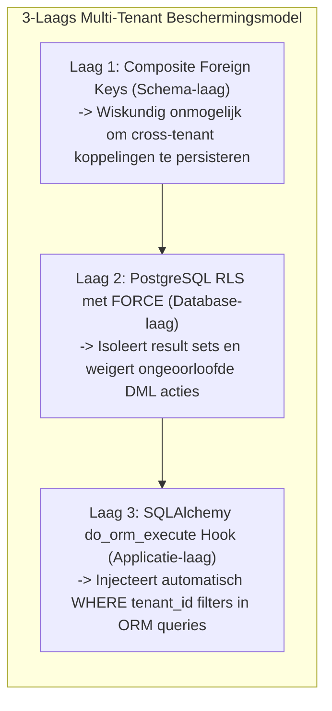

# ADR-005: Database Hardening - NOT NULL & RLS Roadmap

## Status
Accepted | RLS geïmplementeerd op 2026-05-22 (kern-tabellen)

## Context
Code-level isolatie (ADR-004) is gevoelig voor bugs in de ORM-library of fouten in het gebruik van de session-context. Voor een robuust multi-tenant platform is een "defense-in-depth" strategie vereist waar de database zelf als laatste verdedigingslinie fungeert.

## Decision
We implementeren een gelaagde database-beveiliging.

### 1. Schema Hardening (Huidige fase)
Elke tabel die tenant-data bevat MOET voldoen aan:
- **`tenant_id` NOT NULL**: Geen record mag ooit zonder eigenaar bestaan.
- **Indici**: Elke tabel moet een samengestelde index hebben op `(tenant_id, primary_key)` voor performante filtering.

```sql
ALTER TABLE user_data
ADD COLUMN tenant_id UUID NOT NULL,
ADD CONSTRAINT fk_tenant FOREIGN KEY (tenant_id) REFERENCES tenants(id);

CREATE INDEX idx_tenant_data ON user_data(tenant_id, id);
```

### 2. Row Level Security (RLS) Roadmap
De strategische keuze is om Postgres RLS te activeren in de volgende fase van platform-hardening.

**RLS Beleid voorbeeld:**
```sql
ALTER TABLE user_data ENABLE ROW LEVEL SECURITY;

CREATE POLICY tenant_isolation_policy ON user_data
USING (tenant_id = current_setting('app.current_tenant')::uuid);
```
De applicatie stelt dan bij elke session-start de variabele in: `SET app.current_tenant = '...'`.

### 3. Monitoring (SLI)
| Metriek | Meetmethode | SLO |
| :--- | :--- | :--- |
| **Integrity Breach** | DB Constraint Violation | 0 toegestaan (behalve bij migratie) |
| **Audit Coverage** | Logs met tenant_id / Totaal | 100% voor alle DML acties |

## Consequences
- **Positive**:
    - Zelfs bij een kritiek lek in de applicatie-code (bijv. SQL injection) blijft data van andere tenants beschermd door de DB policy.
    - Heldere pad naar een "trustless" database layer.
- **Negative**:
    - RLS introduceert complexiteit in de database-connection pool (sessies moeten netjes worden opgeschoond).
    - Migraties naar RLS vereisen downtime of een zeer zorgvuldige staging.
- **Notes**:
    - We leggen nu de infrastructuur (NOT NULL kolommen) vast om deze overstap later zonder schema-wijziging te kunnen maken.

## SOC 2 Mapping

Dit ADR levert aantoonbaar bewijs voor de volgende SOC 2 Security Criteria:

| Criterium | Subcriteria | Hoe dit ADR voldoet |
| --------- | ---------- | ------------------- |
| CC6.1 | Logical access controls | RLS policies actief op kern-tabellen (`users`, `agents`, `registered_agents`, `tool_audit_logs`); deny-by-default bij ontbrekende tenant context; geen rij wordt teruggegeven als `app.current_tenant` niet is ingesteld |
| CC6.3 | Access restricted based on authorized individual | `SET LOCAL app.current_tenant` injectie door `get_db()` koppelt elke DB-sessie aan de geverifieerde tenant uit de JWT; `NULLIF(..., '')::INTEGER` retourneert NULL en de policy weigert toegang bij ontbrekende context |
| CC6.5 | Logical access security as defense-in-depth | Database fungeert als laatste verdedigingslinie naast ORM-hooks (ADR-004); zelfs bij een volledige bypass van de applicatielaag blijft RLS van kracht |
| CC7.1 | Monitoring of system configurations | `tenant_id NOT NULL` constraint maakt DB constraint-violations meetbaar als SLI; SLO is 0 violations buiten migraties; violations zijn direct zichtbaar in applicatielogboeken |

### Open gaps richting volledige SOC 2 Type I readiness

- RLS is nog niet actief op alle tabellen — alleen kern-tabellen zijn gedekt; uitbreiding naar overige tabellen is een gedocumenteerd roadmap-item maar nog niet gerealiseerd
- Geen geautomatiseerde productie-verificatie van RLS actief op een vast interval; de CI-test valideert de logica maar niet de status in de draaiende productiedatabase

## Implementatie (2026-05-22)

RLS geactiveerd voor kern-tabellen via Alembic migratie `20260522_add_rls_core_tables`:

| Tabel | Policy |
| --- | --- |
| `users` | `core_users_tenant_isolation` |
| `agents` | `core_agents_tenant_isolation` |
| `registered_agents` | `core_registered_agents_tenant_isolation` |
| `tool_audit_logs` | `core_tool_audit_logs_tenant_isolation` |

Policy-patroon (deny-by-default bij ontbrekende context):

```sql
CREATE POLICY core_{tbl}_tenant_isolation ON {tbl}
  FOR ALL USING (
    tenant_id = NULLIF(current_setting('app.current_tenant', true), '')::INTEGER
  );
```

`NULLIF(..., '')::INTEGER` retourneert NULL als de instelling niet aanwezig is → policy weigert toegang in plaats van te crashen.

### 4. Search Index Tenant Isolation (toegevoegd 2026-05-27)

De vector search en BM25 index lagen zijn **niet** automatisch tenant-geïsoleerd door PostgreSQL RLS, omdat ze buiten de relationele tabellen opereren:

- **Vector indexes**: `RetrievalEngine.global_index` en `KnowledgeManager` vector stores moeten expliciet `tenant_id` filteren bij elke query. Elke vector store entry MOET een `tenant_id` metadata veld hebben.
- **BM25 indexes**: `BM25Service` houdt per-tenant indexes in memory (`dict[int, BM25]`), maar er is geen eviction policy of tenant-scoped persistence validatie. Bij index rebuild moet de tenant_id expliciet worden geverifieerd.
- **Hybrid search**: De fusion-laag (`HybridSearch`) moet garanderen dat **beide** bronnen (BM25 + vector) hetzelfde tenant filter toepassen voordat resultaten worden samengevoegd. Fusie van tenant-scoped en global results is een **cross-tenant leakage vector**.

**Verplichte checks bij elke search query**:
```python
assert search_query.tenant_id is not None, "Tenant isolation required for all search"
assert all(r.tenant_id == search_query.tenant_id for r in results), "Cross-tenant result detected"
```

**RLS-achtig beleid voor search** (toegepast in applicatielaag omdat vector stores geen native RLS hebben):
- `tenant_id NOT NULL` op alle brondocumenten die geïndexeerd worden
- Index rebuild valideert dat 100% van bronnen een geldige `tenant_id` hebben
- Query-time assert dat retrieved chunks alleen de request-tenant bevatten
- Prometheus metric `search_cross_tenant_leakage_detected_total` — moet altijd 0 zijn

`get_db()` injecteert `SET LOCAL app.current_tenant = '{tenant_id}'` vóór elke sessie-yield.
Worker-processen (geen request-middleware) gebruiken `TenantFilterBypass` context manager.
`audit_logs` is bewust uitgesloten (zie CLAUDE.md valkuilen-tabel).

## Bekende implementatiebug (P0-9) — vastgesteld 2026-05-28

**Bestand:** `src/core/shared/config.py:56`

**Probleem:** `database_url` heeft een SQLite default. Als `DATABASE_URL` env var niet gezet
is, start de backend op SQLite. SQLite heeft geen `SET LOCAL app.current_tenant` ondersteuning
en kent geen Row Level Security. De RLS-policies in dit ADR zijn dan volledig non-operationeel.

**Gevolg:** Tenant A kan bij een ontbrekende `DATABASE_URL` de data van Tenant B lezen —
het volledige defense-in-depth model van dit ADR wordt omzeild.

**Vereiste fix:** Verwijder de SQLite default; voeg een Pydantic validator toe die SQLite
afwijst met een `ValueError`. Zie `docs/frontend/pages/22-platform-p0-blockers-scope.md`
(P0-9) voor de volledige fix inclusief tests en tijdsinschatting.

```python
# FOUT (huidige code):
database_url: str = Field(default="sqlite:///./sanskriti_setu.db")

# GOED:
database_url: str = Field(default="")

@validator("database_url", pre=True, always=True)
def require_postgres_url(cls, v: str) -> str:
    if not v:
        raise ValueError("DATABASE_URL is required.")
    if v.startswith("sqlite"):
        raise ValueError(
            "SQLite is not supported. Multi-tenant RLS requires PostgreSQL."
        )
    return v
```

**Prioriteit:** P0 — zonder PostgreSQL is dit ADR non-operationeel

---

### 5. Composite Foreign Keys & Schema-Level Relational Integrity (Toegevoegd 2026-08-21)

#### 5.1 Probleemstelling: Beperkingen van RLS voor Relationele Integriteit

Row-Level Security (RLS) bewaakt **toegangs- en query-isolatie** (welke rijen een query mag lezen of schrijven), maar garandeert **niet** automatisch de *structurele relationele integriteit* tussen entiteiten in koppeltabellen (junction tables zoals `user_roles`, `role_permissions`, `employee_skills`).

**Het risico van enkelvoudige Foreign Keys in multi-tenant koppeltabellen:**
Wanneer een koppeltabel enkelvoudige foreign keys gebruikt (`user_id -> users.id` en `role_id -> roles.id`), valideert PostgreSQL uitsluitend of `user_id` bestaat in `users` en `role_id` bestaat in `roles`. De database controleert **niet** of `users.tenant_id == roles.tenant_id`.

```sql
-- KWETSBAAR ONTWERP:
CREATE TABLE user_roles (
    user_id INTEGER REFERENCES users(id),
    role_id INTEGER REFERENCES roles(id)
);
-- Als Gebruiker 10 (Tenant A) en Rol 99 (Tenant B) bestaan, slaagt:
INSERT INTO user_roles (user_id, role_id) VALUES (10, 99); -- GELUKT! Cross-tenant toewijzing!
```

**Waarom RLS alleen dit risico niet volledig elimineert:**
1. **Privileged Roles & Superusers:** Migratiescripts, seeders, onderhoudstaken en processen met `BYPASSRLS` of superuser-rechten omzeilen RLS volledig en kunnen ongeldige cross-tenant relaties wegschrijven.
2. **Connection Pooling Context Leaks:** Als een sessievariabele (`app.current_tenant`) door een applicatiefout niet zuiver wordt gereset tussen pooled connections, kan data onder een verkeerde tenant-context worden weggeschreven.
3. **Incomplete Policies:** Een policy met alleen `USING` (leesbeveiliging) zonder waterdichte `WITH CHECK` (schrijfbeveiliging) laat ongeoorloofde koppelingen toe.
4. **Koppeltabellen zonder `tenant_id`:** Zonder `tenant_id` kolom kan RLS niet eens rechtstreeks worden toegepast op de koppeltabel zelf (zie migratie `20260522_add_rls_core_tables` regel 9).

#### 5.2 Beslissing: Verplichte Composite Foreign Keys op Koppeltabellen

We hanteren het **Defense-in-Depth principe**: *Relationele integriteit hoort in het schema; query-isolatie hoort in RLS.*

1. **Unieke Samengestelde Sleutels op Hoofdentiteiten:**  
   Elke tenant-gebonden hoofdentiteit (`users`, `roles`, etc.) MOET een unieke constraint hebben op `(tenant_id, id)`:
   ```sql
   ALTER TABLE users ADD CONSTRAINT uq_users_tenant_id UNIQUE (tenant_id, id);
   ALTER TABLE roles ADD CONSTRAINT uq_roles_tenant_id UNIQUE (tenant_id, id);
   ```

2. **Verplichte `tenant_id` Kolom & Composite FKs op Koppeltabellen:**  
   Elke koppeltabel (`user_roles`, `role_permissions`, `employee_skills`, etc.) MOET een `tenant_id NOT NULL` kolom bevatten en samengestelde foreign keys definiëren die refereren naar `(tenant_id, id)` van beide partijen:
   ```sql
   CREATE TABLE user_roles (
       tenant_id INTEGER NOT NULL,
       user_id   INTEGER NOT NULL,
       role_id   INTEGER NOT NULL,

       PRIMARY KEY (user_id, role_id),

       -- Garandeert dat tenant_id bestaat
       CONSTRAINT fk_user_roles_tenant 
           FOREIGN KEY (tenant_id) 
           REFERENCES tenants (id) 
           ON DELETE CASCADE,

       -- Dwingt af dat user_id bij DEZE tenant_id hoort:
       CONSTRAINT fk_user_roles_user 
           FOREIGN KEY (tenant_id, user_id) 
           REFERENCES users (tenant_id, id) 
           ON DELETE CASCADE,

       -- Dwingt af dat role_id óók bij DEZELFDE tenant_id hoort:
       CONSTRAINT fk_user_roles_role 
           FOREIGN KEY (tenant_id, role_id) 
           REFERENCES roles (tenant_id, id) 
           ON DELETE CASCADE
   );
   ```

3. **RLS Policy op Koppeltabellen:**  
   Nu de koppeltabel een `tenant_id` kolom heeft, wordt RLS ook direct op de koppeltabel zelf geactiveerd:
   ```sql
   ALTER TABLE user_roles ENABLE ROW LEVEL SECURITY;
   ALTER TABLE user_roles FORCE ROW LEVEL SECURITY; -- Geldt ook voor table owner

   CREATE POLICY user_roles_tenant_isolation ON user_roles
       FOR ALL USING (
           tenant_id = NULLIF(current_setting('app.current_tenant', true), '')::INTEGER
       )
       WITH CHECK (
           tenant_id = NULLIF(current_setting('app.current_tenant', true), '')::INTEGER
       );
   ```

#### 5.3 Vergelijking & Verdedigingslagen (Defense-in-Depth)



| Eigenschap | Enkelvoudige FK + RLS | Triggers | Composite Foreign Keys + RLS |
|---|---|---|---|
| **Wat bewaakt het?** | Alleen query-zichtbaarheid | Procedurele integriteit | **Wiskundige structurele integriteit + isolatie** |
| **Omzeilbaar door Superuser / Seeder?** | ⚠️ Ja (RLS bypass) | ⚠️ Kan uitgeschakeld worden | **🔒 Nee (harde constraint afgedwongen door engine)** |
| **Transparantie in ERD & DDL** | ❌ Ondoorzichtig | ❌ Verborgen in triggers | **✅ 100% expliciet zichtbaar in ERD & schema** |
| **Gevoelig voor Connection Pool bugs?** | ⚠️ Ja | ❌ Nee | **🔒 Nee (data-gebonden constraint)** |
| **Performance Overhead** | Query rewrite | Context switch per rij | **Geoptimaliseerd via B-tree composite indexen** |

---

## Changelog

| Version | Date | Change |
| --- | --- | --- |
| 1.0 | Initial | NOT NULL + RLS roadmap |
| 1.1 | 2026-05-22 | RLS geimplementeerd op kern-tabellen; SOC 2 mapping toegevoegd |
| 1.2 | 2026-05-27 | §4 Search Index Tenant Isolation toegevoegd |
| 1.3 | 2026-05-28 | P0-9 bug gedocumenteerd: SQLite default in config.py omzeilt RLS volledig |
| **1.4** | **2026-08-21** | **§5 Composite Foreign Keys & Schema-Level Relational Integrity toegevoegd: afdwingen van tenant-consistentie op koppeltabellen (user_roles, role_permissions) via composite constraints** |
